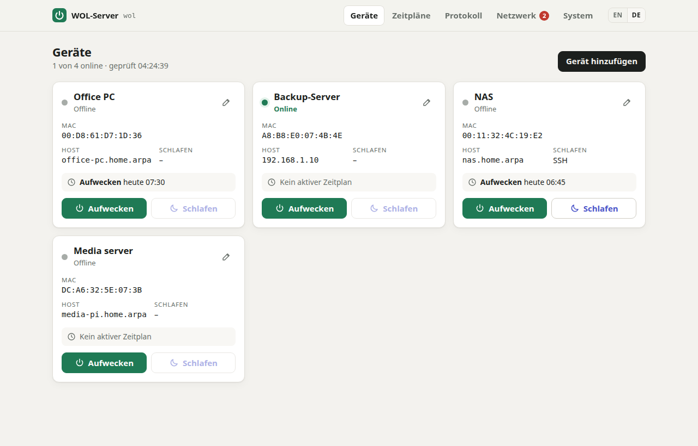
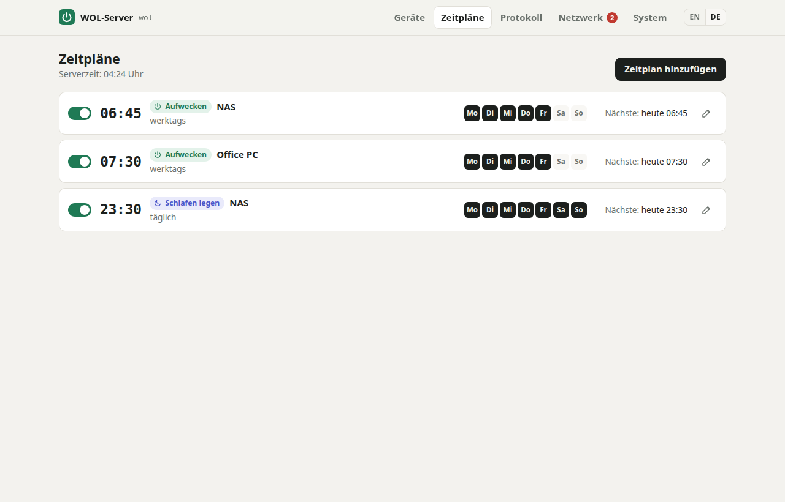
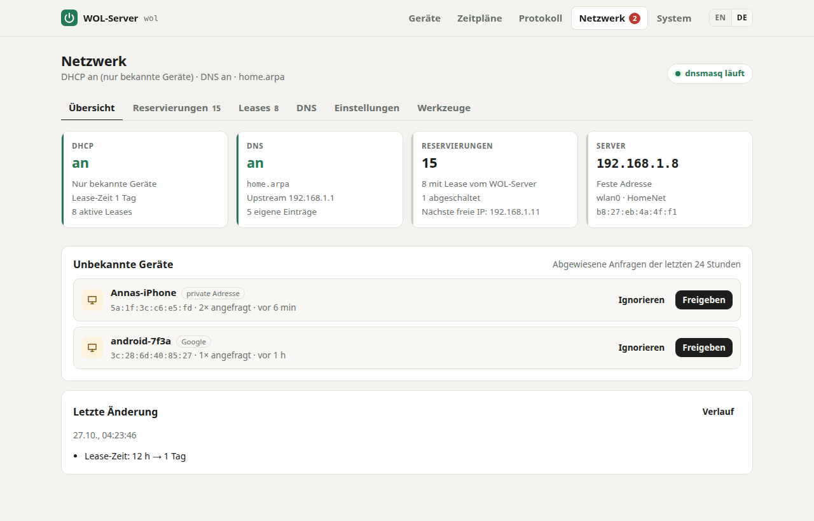
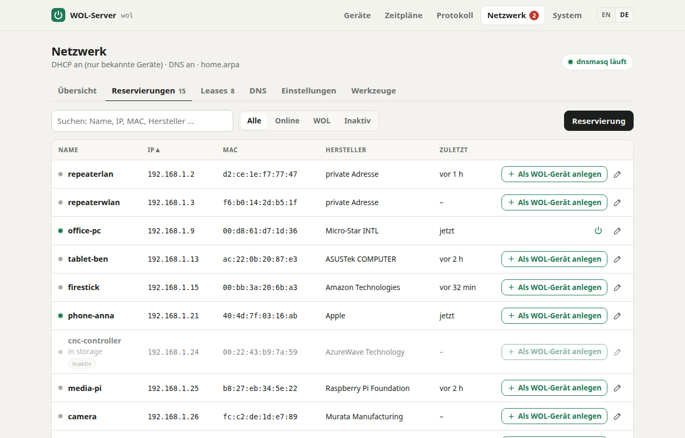
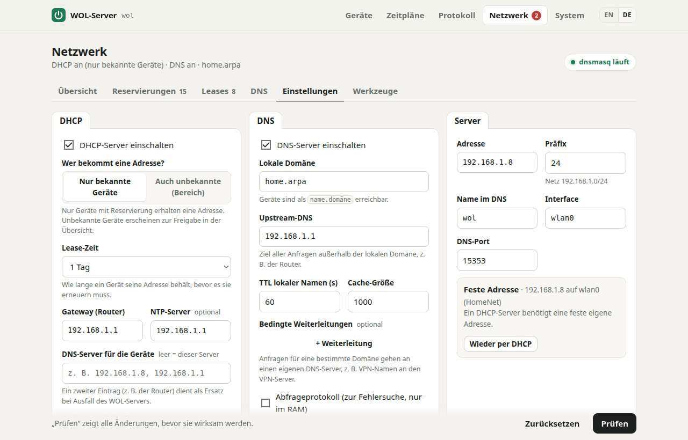
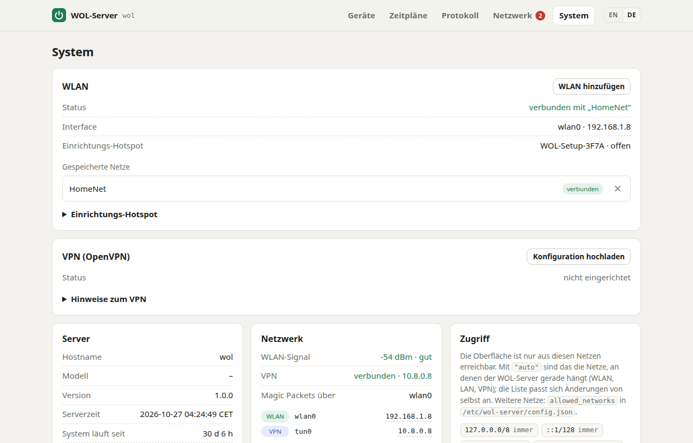
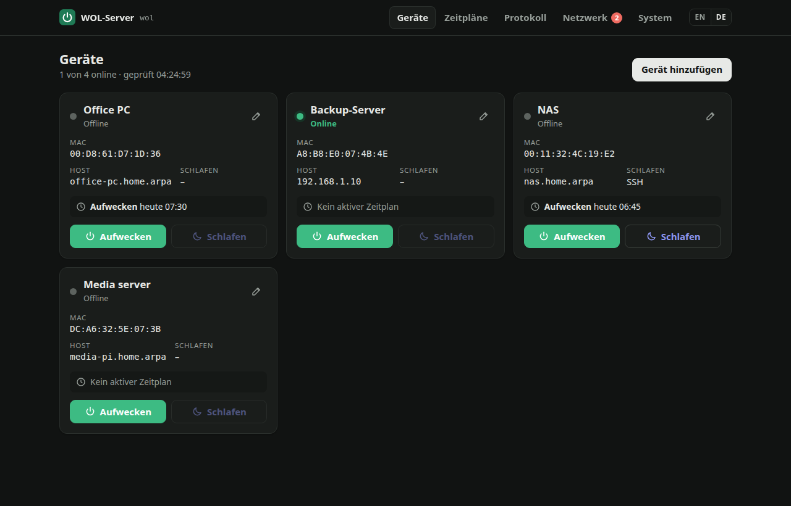
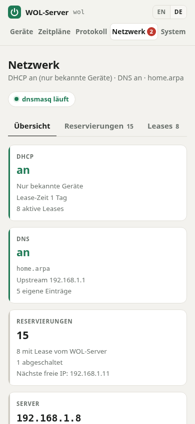

# WOL-Server für den Raspberry Pi Zero W

**Deutsch** · [English](README.md)

> **WOL-Server** – the Low-Power Intranet Network Swiss Army Knife for the Raspberry Pi Zero W

Eine kleine Heimnetz-Zentrale auf einem Raspberry Pi Zero W, die rund um die Uhr läuft und dabei weniger
als ein Watt braucht. Sie weckt Rechner im Heimnetz auf oder legt sie schlafen – manuell oder nach Zeitplan,
aus dem Intranet und über VPN – und übernimmt auf Wunsch DHCP und DNS für das ganze Netz. Alles über eine
Web-GUI, ohne Abhängigkeiten außer Python 3.

<p align="center">
  
</p>

- **Geräte verwalten:** Name, MAC, Host/IP, Broadcast-Adresse, WOL-Port, Schlaf-Methode
- **Aufwecken** per Magic Packet, **Schlafen legen** per SSH-Befehl, HTTP-Aufruf oder Sleep-on-LAN
- **Zeitpläne:** pro Gerät Aufwecken/Schlafen zu einer Uhrzeit an gewählten Wochentagen
- **Online-Status** (ICMP-Ping bzw. TCP-Probe, erkennt auch Windows-PCs mit ICMP-Firewall)
- **Protokoll** aller manuellen und geplanten Aktionen
- **OpenVPN-Client auf dem Pi:** Er ist über das VPN erreichbar, ohne Portfreigabe zu Hause (auch bei DS-Lite/CGNAT)
- **Reiner WLAN-Betrieb:** Powersave aus, WLAN-Watchdog, Hardware-Watchdog; Magic Packets gehen immer ins WLAN,
  nie in den Tunnel
- **Einrichtungs-Hotspot wie bei einer Appliance:** Findet der Pi kein bekanntes WLAN, öffnet er einen eigenen
  Hotspot mit Einrichtungsseite. WLAN wechseln geht ohne Imager, Tastatur oder SD-Karte.
- **Status-LED:** Die grüne LED zeigt, ob die Einrichtung läuft, der Hotspot aktiv ist oder das Netz fehlt.
- **DHCP und DNS fürs Heimnetz (optional):** dnsmasq, verwaltet im Reiter *Netzwerk*. Jedes Gerät ist automatisch
  unter seinem Namen erreichbar; Reservierungen, eigene DNS-Einträge, unbekannte Geräte mit einem Klick freigeben,
  Import vom alten ISC-dhcpd, Verlauf mit Zurückholen.
- **HTTPS mit Let's-Encrypt-Zertifikat:** Ein öffentlicher Webserver erneuert das Zertifikat, der Pi holt es über
  das VPN ab; HTTP leitet automatisch auf HTTPS um.
- **Zugriff nur aus LAN/VPN:** Die Allowlist folgt automatisch den eigenen Netzen (WLAN, VPN-Tunnel);
  Passwort-Login, CSRF-Schutz, gehärteter systemd-Dienst
- **Fehlersuche per Kartenleser:** Einrichtungs-, Start- und Ablaufprotokolle liegen auf der Boot-Partition
- **GUI auf Englisch und Deutsch:** kleiner Umschalter in der Kopfzeile, Vorgabe ist die Browsersprache
- **Keine Abhängigkeiten** außer Python 3 (Standardbibliothek) – kein pip, kein Node, keine Datenbank, kein CDN

```
 Handy unterwegs ──► OpenVPN-Server ◄──(tun0, ausgehend)── Pi Zero W ──(wlan0)──► WLAN-Router ──(LAN)──► PC / NAS
 Laptop zu Hause ─────────────(WLAN/LAN)──────────────────►   :80                  Magic Packet (Broadcast)
                                                                └──(SSH / HTTP / Sleep-on-LAN)──► schlafen legen
```

Warum ein Pi? Magic Packets sind Layer-2-Broadcasts und kommen nicht durch einen VPN-Tunnel. Der Pi steht im
Heimnetz und schickt das Paket dort stellvertretend ab. Dafür baut er selbst den OpenVPN-Tunnel nach außen auf.

### Hardware und Stromverbrauch im Dauerbetrieb

Gedacht für den **Raspberry Pi Zero W** (512 MB RAM, ein Kern, nur WLAN). Er reicht für alles hier, weil der
Server mit der Python-Standardbibliothek auskommt, im Leerlauf nicht pollt und Logs nur im RAM hält.

| | Leistung | pro Jahr (24/7) | Kosten bei 35 ct/kWh |
|---|---|---|---|
| Pi Zero W im Leerlauf, WLAN verbunden, HDMI und Bluetooth aus | ca. 0,4–0,7 W | ca. 3,5–6 kWh | ca. 1,20–2,10 € |
| zum Vergleich: kleiner PC oder NAS im Dauerbetrieb | 15–30 W | 130–260 kWh | 46–92 € |

Die Werte für den Zero sind typische Angaben (ca. 80–140 mA bei 5 V), keine eigene Messung. `lowpower.sh` schaltet
HDMI (ca. 25 mA), Bluetooth und Audio ab. WLAN-Powersave bleibt bewusst aus, weil Erreichbarkeit vorgeht;
`over_voltage=2` (für die Stabilität unter Last, siehe [Speicher sparen](#speicher-sparen-lowmemsh)) kostet
etwas mehr. Ein stabiles Netzteil mit mindestens 1,2 A ist wichtig: Unterspannung äußert sich auf dem Zero W
in zufälligen Abstürzen.

### Screenshots

| | |
|---|---|
|  |  |
| **Zeitpläne** pro Gerät, werktags oder täglich | **Netzwerk:** DHCP, DNS, Reservierungen und unbekannte Geräte auf einen Blick |
|  |  |
| **Reservierungen** mit Hersteller, Status und Aufwecken direkt aus der Liste | **Einstellungen** für DHCP, DNS und Server, mit Prüfen vor dem Übernehmen |
|  |  |
| **System:** WLAN, VPN, Zugriff, HTTPS-Status | **Dunkles Design** folgt der Systemeinstellung |

<p align="center">
  <br>
  <em>Auch auf dem Handy bedienbar</em>
</p>

---

## 1. SD-Karte vorbereiten

Es gibt zwei Wege:
- **Variante A: fertiges Image.** Karte schreiben, Pi einstecken, fertig. Kein SSH, keine Tastatur, keine
  Imager-Einstellungen. Empfohlen.
- **Variante B: Imager und SSH.** Raspberry Pi OS installieren, danach den WOL-Server per SSH aufspielen.

### Variante A: fertiges Image (ohne SSH)

Auf einem Linux-PC (ohne root; benötigt `mtools`, `xz-utils`, `fdisk` und `curl`):

```bash
cp deploy/firstboot/wol-setup.txt meine-einstellungen.txt   # anpassen: GUI-Passwort, Hostname, ggf. WLAN
./deploy/make-image.sh -c meine-einstellungen.txt \
    --ovpn client.ovpn --ovpn-auth vpn-zugang.txt \
    --xz -o wol-server.img                                   # VPN-Optionen weglassen, wenn nicht gebraucht
```

Das Skript lädt das aktuelle **Raspberry Pi OS Lite (32-bit)** und prüft seine Prüfsumme. Anschließend legt es
WOL-Server, Einstellungen und ggf. VPN-Konfiguration auf die Boot-Partition. Das Ergebnis `wol-server.img.xz`
mit einem beliebigen Programm auf die Karte schreiben:
- **Raspberry Pi Imager:** *Eigenes Image* wählen und die Frage nach **OS-Anpassungen mit „Nein“**
  beantworten. Sonst ersetzt der Imager die Startkonfiguration.
- **balenaEtcher** oder `xzcat wol-server.img.xz | sudo dd of=/dev/sdX bs=4M conv=fsync`

Karte in den Pi, Strom an. Beim ersten Start richtet sich der Pi selbst ein, das dauert auf dem Zero W etwa
5–10 Minuten. Danach startet er einmal neu (Speicher- und Stromsparmodus) und öffnet den Hotspot **`WOL-Setup-XXXX`**, über
den das Heim-WLAN gewählt wird (siehe [WLAN einrichten](#wlan-einrichten-und-wechseln-einrichtungs-hotspot)).
War in den Einstellungen ein WLAN eingetragen, ist er direkt unter `http://wol.local/` erreichbar.
Solange die Einrichtung läuft, blinkt die grüne LED schnell (siehe [Status-LED](#status-led)).

Was beim ersten Start passiert (`deploy/firstboot.sh`, gestartet von cloud-init):
- Es setzt Hostname, Zeitzone und WLAN-Land und richtet optional den Wartungszugang ein (`SSH=yes`, Schlüssel
  per `--ssh-key`).
- Es installiert den WOL-Server samt WLAN-Absicherung und Hotspot. Raspberry Pi OS Lite bringt dafür alle Pakete
  mit, Internet ist nicht nötig.
- Es setzt das GUI-Passwort aus den Einstellungen.
- OpenVPN wird automatisch nachinstalliert, sobald der Pi über das WLAN Internet hat.
- Danach löscht es Einstellungen, VPN-Schlüssel und Quellen von der Boot-Partition. Das Protokoll liegt dort als
  `wol-setup.log` (schon während der Einrichtung), auf dem Pi unter `/var/log/wol-firstboot.log`.
- Bricht der Pi mittendrin ab (Stromausfall, Hänger), setzt er die Einrichtung beim nächsten Start fort
  (`wol-firstboot.service`).

> **Ohne Linux-PC:** Das offizielle Raspberry Pi OS Lite (32-bit) ohne OS-Anpassungen schreiben. Dann auf die
> Boot-Partition (`bootfs`) kopieren: den Inhalt von `deploy/firstboot/` (`user-data`, `userconf.txt`,
> `wol-setup.txt` zum Anpassen) und dieses Projektverzeichnis als Ordner **`wol-server`**. Optional kommen
> `openvpn.ovpn`, `openvpn.auth` und `ssh_authorized_keys` dazu.

**Achtung:** Image und Karte enthalten bis zum ersten Start Passwörter und ggf. den privaten VPN-Schlüssel.
Das Image deshalb nicht weitergeben und nach dem Schreiben löschen.

### Variante B: Imager und SSH

Mit dem **Raspberry Pi Imager**:

1. Gerät: *Raspberry Pi Zero* · Betriebssystem: **Raspberry Pi OS Lite (32-bit)**
   (der Zero W hat eine ARMv6-CPU; 64-bit läuft nur auf dem Zero 2 W)
2. Unter „Einstellungen bearbeiten“:
   - Hostname, z. B. `wol` (die GUI ist dann unter `http://wol.local/` erreichbar)
   - Benutzer und Passwort
   - WLAN (SSID, Passwort, Land `DE`): nur für die Erstinstallation per SSH nötig, siehe unten
   - Zeitzone `Europe/Berlin`. **Wichtig für die Zeitpläne**, denn sie laufen in der Zeitzone des Pi.
   - Unter „Dienste“: **SSH aktivieren**
3. Karte schreiben, in den Pi stecken, booten (der erste Start dauert ein paar Minuten).

Der Imager wird nur dieses eine Mal gebraucht. Nach der Installation richtet der Pi neue oder geänderte WLANs
über seinen **Einrichtungs-Hotspot** ein (siehe [WLAN einrichten](#wlan-einrichten-und-wechseln-einrichtungs-hotspot)).

> **Tipp:** Im Router dem Pi eine feste IP zuweisen (z. B. FRITZ!Box: *Heimnetz → Netzwerk → Gerät → „Diesem
> Netzwerkgerät immer die gleiche IPv4-Adresse zuweisen“*).

## 2. Installieren (Variante B)

Vom eigenen Rechner aus:

```bash
scp -r WOL-Server <benutzer>@wol.local:~/
ssh <benutzer>@wol.local
cd ~/WOL-Server
sudo ./deploy/install.sh --openvpn ~/client.ovpn   # fragt nach GUI-Passwort (und ggf. VPN-Zugang)
sudo ./deploy/lowmem.sh                            # optional, empfohlen
sudo ./deploy/lowpower.sh                          # optional, empfohlen – danach: sudo reboot
```

`install.sh` legt den Systembenutzer `wol` an, kopiert das Programm nach `/opt/wol-server`, schreibt
`/etc/wol-server/config.json`, erzeugt einen SSH-Schlüssel und startet den Dienst `wol-server`.
Außerdem richtet es die WLAN-Absicherung (`wlan-setup.sh`) und den Einrichtungs-Hotspot (`hotspot-setup.sh`)
ein, beide siehe unten, und mit `--openvpn` den VPN-Client (`openvpn-setup.sh`, siehe Abschnitt 4).
Das Skript lässt sich gefahrlos erneut ausführen, so werden auch **Updates** eingespielt.
Daten und Konfiguration bleiben dabei erhalten.

Optionen:
- `--port 8080`: anderer Port
- `--no-password`: keine Passwortabfrage
- `--openvpn <datei.ovpn>`: OpenVPN-Client einrichten
- `--country AT`: WLAN-Land (Standard `DE`), wichtig für erlaubte Kanäle und Sendeleistung
- `--no-wlan-setup`: ohne WLAN-Absicherung
- `--no-hotspot`: ohne Einrichtungs-Hotspot

### WLAN-Betrieb: `wlan-setup.sh`

Der Zero W hat nur WLAN. Damit der Server trotzdem zuverlässig erreichbar bleibt, richtet `install.sh`
automatisch Folgendes ein. Einzeln lässt es sich mit `sudo ./deploy/wlan-setup.sh` ausführen.

| Maßnahme | Wirkung |
|---|---|
| WLAN-Powersave aus | Ohne diese Einstellung verpasst der Zero eingehende Verbindungen und Broadcasts. Kostet nur wenige mA. |
| Feste MAC-Adresse | Der Pi meldet sich in jedem WLAN mit seiner Hardware-MAC an, nie mit einer zufälligen. Damit greifen DHCP-Reservierung und Freigaben im Router. |
| WLAN-Watchdog (Timer, jede Minute) | Pingt das Gateway. Nach 3 Fehlschlägen wird das WLAN neu verbunden, nach 30 min ohne Netz startet der Pi neu (frühestens 1 h nach dem Boot). Läuft der Einrichtungs-Hotspot, hält sich der Watchdog heraus. Einstellbar in `/etc/default/wol-wlan-watchdog`. |
| Hardware-Watchdog | Startet den Pi neu, falls das System komplett hängt |

Der Watchdog protokolliert ins Journal: `journalctl -t wlan-watchdog`.

### WLAN einrichten und wechseln: Einrichtungs-Hotspot

Neuer Router, geändertes WLAN-Passwort, Umzug: Findet der Pi keines seiner gespeicherten WLANs, öffnet er nach
5 Minuten einen eigenen Hotspot. Ist noch gar kein WLAN gespeichert, geschieht das schon 30 Sekunden nach dem Start.

1. Mit dem Handy oder Laptop mit dem WLAN **`WOL-Setup-XXXX`** verbinden. `XXXX` sind die letzten Stellen der
   WLAN-MAC-Adresse.
2. Die Einrichtungsseite öffnet sich von selbst (Captive Portal). Falls nicht: **`http://10.42.0.1/`** aufrufen.
3. Anmelden (sofern ein GUI-Passwort gesetzt ist), WLAN aus der Liste wählen, Passwort eingeben, *Verbinden*.
   Optional *Feste IP-Adresse*: Adresse mit Präfix (z. B. `192.168.1.8/24`), Gateway und DNS-Server. Das ist
   nötig, wenn der WOL-Server später selbst DHCP-Server wird, und funktioniert auch in einem Netz ohne DHCP.
4. Der Pi beendet den Hotspot und verbindet sich. Danach ist die GUI wieder im Heimnetz erreichbar, z. B. unter
   `http://wol.local/` oder der festen Adresse. Klappt die Verbindung nicht, etwa weil das Passwort falsch ist, öffnet sich der Hotspot
   nach etwa einer Minute wieder und die Seite zeigt den Fehler.

Im Normalbetrieb verwaltet *System → WLAN* die gespeicherten Netze. Zusätzliche WLANs lassen sich vorab
eintragen, etwa für einen Umzug. Der Pi nutzt sie automatisch, sobald das aktuelle WLAN nicht mehr erreichbar
ist.

Gut zu wissen:
- Der Zero W hat nur einen 2,4-GHz-Funkchip. Hotspot und WLAN-Client gehen **nicht gleichzeitig**. Während der
  Hotspot läuft, schaltet der Pi ihn deshalb alle 5 Minuten kurz ab und sucht nach den gespeicherten WLANs. Das
  passiert nicht, solange ein Gerät mit dem Hotspot verbunden ist oder die Einrichtungsseite benutzt wird.
- Die WLAN-Liste im Hotspot stammt aus der Suche direkt vor dem Start, denn im Hotspot-Betrieb kann der Chip
  nicht scannen. Fehlt ein Netz, den Namen von Hand eingeben.
- **Sicherheit:** Der Hotspot ist anfangs offen, damit die Ersteinrichtung ohne Vorwissen klappt. Die GUI ist
  durch ihr Passwort geschützt. Unter *System → WLAN → Einrichtungs-Hotspot* lässt sich ein WPA2-Passwort
  setzen. Hotspot-Clients dürfen die GUI immer nutzen, auch wenn `10.42.0.0/24` nicht in `allowed_networks`
  steht.
- Während der Hotspot läuft, ist der Pi nicht im Heimnetz. Fällige Zeitpläne werden dann nicht ausgeführt und
  als Fehler protokolliert.
- Technik: Ein eigener Dienst `wol-wifi` steuert den Hotspot als root über NetworkManager. Der Web-Server
  spricht mit ihm über einen Unix-Socket und braucht selbst keine Rechte am Netzwerk. Einzeln einrichten:
  `sudo ./deploy/hotspot-setup.sh --country DE`.

### Status-LED

Der Zero hat keinen Bildschirm, deshalb zeigt die grüne Aktivitäts-LED den Zustand:

| LED | Bedeutung |
|---|---|
| schnelles Blinken | Einrichtung beim ersten Start läuft, oder der Pi verbindet sich gerade mit einem WLAN |
| Herzschlag (Doppelblitz) | Einrichtungs-Hotspot `WOL-Setup-XXXX` ist aktiv: Handy damit verbinden |
| langsames Blinken (1 s an, 1 s aus) | kein Netz; nach 5 Minuten startet der Hotspot |
| normales Flackern bei SD-Zugriffen | im WLAN, alles in Ordnung (mit `lowpower.sh --led-off`: aus) |

Die Muster laufen im Kernel und kosten keine CPU. Abschalten mit `"status_led": false` in der Konfiguration.

**Als fertiges Gerät weitergeben oder ein Image erstellen:** Nach der Installation die gespeicherten WLANs löschen
(`sudo nmcli connection delete <Name>`, Namen mit `nmcli connection show`) und den Pi herunterfahren. Beim nächsten
Start öffnet er sofort den Hotspot. Die SD-Karte lässt sich in diesem Zustand auch als Image für weitere Geräte
sichern.

### Speicher sparen: `lowmem.sh`

Stellt Raspberry Pi OS auf die 512 MB des Zero W ein. Beim Image läuft es am Ende der Einrichtung, die
Änderungen wirken nach dem anschließenden Neustart.

| Maßnahme | Wirkung |
|---|---|
| KMS-Grafiktreiber aus | weniger Treiber und Grafikspeicher |
| `over_voltage=2` (nur Zero W) | stabiler Betrieb unter Last, siehe unten |
| Kamera-, Video-Codec- und Audiotreiber gesperrt, Kamera-/Display-Erkennung aus | weniger Kernel-Module |
| Swap nur als zram (`/etc/rpi/swap.conf.d`), `vm.swappiness=100`, `vm.page-cluster=0` | keine Swap-Datei auf der SD-Karte |
| `apt-daily`, `man-db` und weitere tägliche Timer aus | keine täglichen apt-Läufe, die auf dem Zero viel RAM und CPU brauchen |

`gpu_mem` bleibt bewusst beim Standard (64 MB). Mit `gpu_mem=16` läuft die Firmware über und überschreibt
Speicher: Der Zero W stürzte damit unter Last mit zufälligen Kernel-Oopses ab ([Forum][gpu16]). Kamera- und
Codec-Puffer liegen bei Trixie ohnehin im CMA, die Einstellung bringt kaum noch etwas. Unabhängig davon laufen
manche Zero-W-Boards mit den 6.x-Kerneln bei Standardspannung unter Speicher- und Kartenlast nicht stabil
([raspberrypi/linux#5572][ov]); `over_voltage=2` behebt das (ohne `force_turbo` bleibt die Garantie erhalten).

[gpu16]: https://forums.raspberrypi.com/viewtopic.php?t=316155
[ov]: https://github.com/raspberrypi/linux/issues/5572

Ein eigener Kernel ist nicht nötig: Er brächte nur wenige MB und bekäme keine Updates über apt mehr.
AppArmor und IPv6 bleiben aktiv. Speicher-Cgroups schaltet die Firmware des Zero selbst ab (`cgroup_disable=memory`),
`MemoryMax` der Dienste wirkt dort also nicht. Die Kernel-Parameter in
`cmdline.txt` bleiben unverändert. Vorher wird `config.txt` gesichert (`config.txt.bak-<datum>`).

### Stromsparen: `lowpower.sh`

| Maßnahme | Wirkung |
|---|---|
| HDMI aus | ca. 25 mA weniger |
| Bluetooth aus (`disable-bt`, `hciuart`, `bluetooth`) | weniger Strom, weniger Dienste |
| `triggerhappy`, `ModemManager` aus | weniger Hintergrundprozesse |
| Journal nur im RAM, SD-Swap aus | schont die SD-Karte |
| `--led-off` | grüne Aktivitäts-LED im Normalbetrieb aus (Statusmuster bleiben) |

Vorher wird `config.txt` gesichert (`config.txt.bak-<datum>`). Mit `--keep-hdmi` / `--keep-bluetooth`
lassen sich einzelne Maßnahmen überspringen.

## 3. Zielgeräte vorbereiten

### Wake-on-LAN aktivieren

- **BIOS/UEFI:** „Wake on LAN“, „Power On by PCI-E“ o. ä. aktivieren, „ErP/EuP“ deaktivieren.
- **Linux:** `sudo ethtool -s eth0 wol g`, dauerhaft mit NetworkManager:
  `nmcli connection modify "<Verbindung>" 802-3-ethernet.wake-on-lan magic`
- **Windows:** Geräte-Manager → Netzwerkadapter → Eigenschaften
  - Energieverwaltung: „Gerät kann den Computer aus dem Ruhezustand aktivieren“ und „Nur Magic Packet …“
  - Erweitert: „Wake on Magic Packet“ = Aktiviert
  - Zum Aufwecken aus dem *ausgeschalteten* Zustand den **Schnellstart deaktivieren**
    (Energieoptionen → „Auswahl der Netzschaltertasten“)
- Das Zielgerät sollte **per Kabel** angeschlossen sein, denn WOL über WLAN unterstützen nur wenige Geräte.

**Der Pi im WLAN:** Der Router bzw. Access Point reicht den Broadcast aus dem WLAN ins Kabelnetz weiter. Dafür
gilt:
- Der Pi muss im **selben Netz** wie die Zielgeräte sein, also **nicht im Gast-WLAN**.
- Am Access Point darf **keine Client-Isolation** aktiv sein.
- Mesh-Repeater (FRITZ!Repeater u. ä.) leiten Broadcasts normalerweise weiter.
- WLAN-Broadcasts werden nicht bestätigt; der Server sendet jedes Magic Packet deshalb 5-mal.
- Die Signalstärke zeigt die GUI unter *System → Netzwerk* (besser als ca. −70 dBm ist gut).

Kommt das Paket nicht an, in der GUI als Broadcast-Adresse die des eigenen Netzes eintragen
(z. B. `192.168.178.255` statt `255.255.255.255`).

### Schlafen legen

Wake-on-LAN kennt kein „Schlafen“. Der WOL-Server bietet drei Wege:

**SSH** (empfohlen für Linux, macOS, Windows mit OpenSSH-Server). Den öffentlichen Schlüssel aus
*System → SSH-Schlüssel* auf dem Ziel eintragen:

```bash
# Linux-Zielgerät, als der in der GUI eingetragene Benutzer:
echo 'ssh-ed25519 AAAA… wol-server@wol' >> ~/.ssh/authorized_keys
echo "$USER ALL=(root) NOPASSWD: /usr/bin/systemctl suspend, /usr/bin/systemctl poweroff" \
  | sudo tee /etc/sudoers.d/wol-server
```

Befehl in der GUI: `sudo systemctl suspend`.

Windows: „Optionale Features“ → *OpenSSH-Server* installieren. Bei Administrator-Konten gehört der Schlüssel in
`C:\ProgramData\ssh\administrators_authorized_keys`. Befehl: `shutdown /h` (Ruhezustand) oder
`rundll32.exe powrprof.dll,SetSuspendState 0,1,0` (Standby, wenn der Ruhezustand deaktiviert ist).

Beim ersten Verbinden merkt sich der Server den Host-Key des Ziels (`accept-new`).

**HTTP:** Ruft eine URL auf (GET/POST/PUT, optional mit Body). Das passt z. B. für Home Assistant, ein NAS-API
oder einen eigenen Sleep-Endpunkt.

**Sleep-on-LAN:** Sendet ein Magic Packet mit umgekehrter MAC. Dafür muss auf dem Ziel ein passender Dienst
laufen, z. B. [sleep-on-lan](https://github.com/SR-G/sleep-on-lan) (Windows/Linux).

## 4. Zugriff über VPN (OpenVPN-Client auf dem Pi)

Der Pi verbindet sich als **OpenVPN-Client** mit einem OpenVPN-Server, z. B. auf einem VPS, im Router oder auf
einem NAS. Andere VPN-Teilnehmer (Handy, Laptop) erreichen ihn dann über seine VPN-Adresse. Weil der Tunnel vom
Pi nach außen aufgebaut wird, braucht es zu Hause keine Portfreigabe; das funktioniert auch hinter DS-Lite/CGNAT.

**Über die Web-GUI:** *System → VPN → Konfiguration hochladen*, die `.ovpn`-Datei wählen, bei Bedarf Benutzername
und Passwort eingeben. Der Pi installiert OpenVPN (braucht Internet, dauert auf dem Zero ein paar Minuten),
richtet den Client ein und schaltet ihn ein. Danach zeigt die GUI Status, VPN-Adresse und Server; Ein/Aus und
Entfernen gehen ebenfalls dort.
- Die Datei muss die Zertifikate eingebettet enthalten (`<ca>`, `<cert>`, `<key>`, `<tls-auth>` …).
- Optionen, die Programme ausführen oder Dateien schreiben (`up`, `down`, `script-security`, `plugin`, `log`,
  `management` …), lehnt der Pi ab, denn OpenVPN läuft als root.
- Technik: Die GUI übergibt die Datei an den Root-Dienst `wol-wifi`, der sie prüft und einen Auftrag schreibt.
  Den führt `wol-vpn.service` aus (gestartet von `wol-vpn.path`) und ruft dafür `openvpn-setup.sh` auf.

Auf der Kommandozeile geht es genauso:

```bash
sudo ./deploy/openvpn-setup.sh ~/client.ovpn      # oder gleich: install.sh --openvpn ~/client.ovpn
```

Das Skript erledigt Folgendes:
- installiert `openvpn` und legt die Konfiguration als `/etc/openvpn/client/wol.conf` ab (Modus 0600)
- fragt Benutzername und Passwort ab, falls die Konfiguration `auth-user-pass` nutzt; die Zugangsdaten landen
  in `/etc/openvpn/client/wol.auth`, denn headless kann OpenVPN nicht nachfragen
- kopiert referenzierte Dateien (`ca ca.crt` …) mit; Konfigurationen mit Inline-Zertifikaten gehen direkt
- sorgt für unbegrenzte Neuverbindung nach WLAN- oder Server-Ausfällen (`connect-retry`, `ping-restart`,
  systemd `Restart=always`)
- **ignoriert `redirect-gateway` und gepushte DNS-Server.** Der Pi soll über das VPN nur *erreichbar* sein,
  nicht seinen gesamten Verkehr durch den Tunnel schicken. Das spart CPU auf dem Single-Core-Zero.
  `--allow-redirect-gateway` schaltet das ab. Magic Packets gehen in jedem Fall ins WLAN, weil der Server sie an
  die WLAN-Adresse bindet.
- zeigt am Ende die URL im VPN an, z. B. `http://10.8.0.6/`

### Externer OpenVPN-Server (VPS o. ä.)

Pi und Handy/Laptop sind beide **Clients** desselben Servers. Damit sie sich gegenseitig erreichen, braucht die
Server-Konfiguration (z. B. `/etc/openvpn/server/server.conf`) diese Einstellungen:

```
topology subnet
server 10.8.0.0 255.255.255.0
client-to-client                 # Clients dürfen untereinander sprechen (ohne Kernel-Forwarding)
client-config-dir /etc/openvpn/ccd
keepalive 10 60                  # Abbrüche (WLAN!) schnell erkennen, Client verbindet neu
```

Feste Adresse für den Pi, damit die URL stabil bleibt. Der Dateiname ist der **Common Name** des
Pi-Zertifikats bzw. bei `username-as-common-name` der VPN-Benutzername:

```
# /etc/openvpn/ccd/wol-pi
ifconfig-push 10.8.0.6 255.255.255.0
```

Danach den Server neu starten. Die GUI ist dann von jedem VPN-Client aus unter `http://10.8.0.6/` erreichbar.

Hinweise:
- **Jeder Client braucht ein eigenes Zertifikat** bzw. einen eigenen Benutzer. Bei geteilten Zertifikaten
  (`duplicate-cn`) funktioniert die feste Adresse nicht zuverlässig.
- **Kommerzielle VPN-Dienste** (NordVPN, ProtonVPN usw.) eignen sich nicht: Sie isolieren Clients
  voneinander, der Pi wäre über sie nicht erreichbar.
- Der Pi kann über das VPN nur sich selbst anbieten. Die Geräte im Heimnetz sind über das VPN nicht direkt
  erreichbar, und das ist für den WOL-Server auch nicht nötig. Wer das trotzdem will, braucht auf dem Server
  `route`/`iroute` für das Heimnetz und auf dem Pi IP-Forwarding mit NAT. Das ist nicht Teil dieses Projekts.
- Das VPN-Subnetz darf sich nicht mit dem Heimnetz oder dem Netz unterwegs überschneiden (z. B. VPN
  `10.8.0.0/24`, Heimnetz `192.168.178.0/24`).
- Firewall des VPS: Nur der OpenVPN-Port (Standard UDP 1194) muss offen sein.
- Pi-Zertifikat widerrufen bei Verlust der SD-Karte: Die Schlüssel liegen dort unverschlüsselt in
  `/etc/openvpn/client/`.

Die GUI ist nur aus den Netzen in `allowed_networks` erreichbar. Der Standard `"auto"` erlaubt localhost,
IPv6-Link-local und die Netze, an denen der Pi gerade hängt, also auch das Netz des VPN-Tunnels. Die Liste
passt sich neuen Adressen und VPN-Netzen von selbst an. Kommen VPN-Clients aus einem anderen Netz als dem des
Tunnels (geroutete Netze), dieses in `/etc/wol-server/config.json` ergänzen, z. B.
`"allowed_networks": ["auto", "10.9.0.0/24"]`, und `sudo systemctl restart wol-server` ausführen. Den
VPN-Status samt Adresse zeigt die GUI unter *System → Netzwerk*.

> Die GUI spricht bewusst nur HTTP: Sie ist ausschließlich im LAN/VPN erreichbar, und der VPN-Verkehr ist
> verschlüsselt. **Den Port niemals per Portfreigabe ins Internet öffnen.**

Ein OpenVPN-Client verursacht auf dem Zero W im Leerlauf kaum Last (nur Keepalives). Für die wenigen Kilobyte
der GUI reicht die Leistung problemlos.

## 5. DHCP und DNS (Reiter „Netzwerk“)

Der WOL-Server kann DHCP und DNS für das Heimnetz übernehmen, zum Beispiel als Ersatz für einen ISC-dhcpd mit
BIND und Webmin. Dahinter steckt **dnsmasq**: DHCP und DNS in einem Prozess, darum ist jedes Gerät, das eine
Adresse bekommt, sofort als `name.domäne` erreichbar, auch rückwärts von der IP zum Namen. Abgelaufene Leases
verschwinden wieder. Hintergrund und Entscheidungen: [docs/vorschlag-dhcp-dns.md](docs/vorschlag-dhcp-dns.md).

Bis du es in der GUI einschaltest, bleibt alles aus. `hotspot-setup.sh` (läuft mit `install.sh`) stellt nur die
Dienste bereit.

**Bedienung:** *Übernehmen* macht eine Änderung sofort wirksam, etwa bei Reservierungen und DNS-Einträgen.
In den Einstellungen zeigt *Prüfen* vorher alle Änderungen, die Bestätigung mit *Übernehmen* macht sie wirksam.
Beim Übernehmen prüft der Pi die neue Konfiguration mit `dnsmasq --test`, lädt neu (Reservierungen ohne
Unterbrechung per SIGHUP) und testet DNS. Schlägt etwas fehl, stellt er den vorherigen Stand selbst wieder her.
Import, Sicherung und Verlauf erzeugen einen **Entwurf**. Die Leiste oben zeigt die offenen Änderungen; weitere
Änderungen landen bis zum Übernehmen oder Verwerfen im Entwurf.

| Bereich | Inhalt |
|---|---|
| Übersicht | Status, Hinweise (z. B. „ein weiterer DHCP-Server antwortet“), **unbekannte Geräte** mit *Freigeben* (Name und nächste freie IP vorbelegt, sofort wirksam) oder *Ignorieren* |
| Reservierungen | MAC → IP → Name, Kommentar, aktiv/inaktiv, eigene Lease-Zeit; Suche, Filter, Hersteller, „zuletzt gesehen“; WOL-Geräte direkt wecken |
| Leases | aktive Vergaben mit Restlaufzeit; *Reservieren*, *Als WOL-Gerät*, *Freigeben* |
| DNS | Testabfrage, Cache-Statistik, eigene Einträge (Name → IP, Alias, MX, SRV, TXT), Abfrageprotokoll |
| Einstellungen | DHCP (Modus „nur bekannte Geräte“ oder Adressbereich, Lease-Zeit, Gateway, DNS, NTP, Suchdomänen), DNS (Domäne, Upstream, bedingte Weiterleitungen), Server (feste Adresse setzen), Netzwerkstart (PXE) |
| Werkzeuge | Import aus `dhcpd.conf` mit Vorschau, Sicherung als JSON, Suche nach anderen DHCP-Servern, dnsmasq neu starten, Verlauf mit Zurückholen, DHCP-/Dienstprotokoll, ignorierte Geräte |

**Umzug von einem ISC-dhcpd** (Ablauf mit Rückweg im [Vorschlag](docs/vorschlag-dhcp-dns.md#6-umzug-von-10)):
1. *Einstellungen → Server → Feste Adresse setzen.* Ein DHCP-Server braucht eine feste eigene Adresse.
2. *Werkzeuge → dhcpd.conf importieren.* Namen werden für DNS bereinigt (`LinuxCNC_Alfa` → `linuxcnc-alfa`). Der
   Eintrag des WOL-Servers selbst wird übersprungen.
3. DNS einschalten, übernehmen und testen: `dig @<pi> office-pc.home.arpa`. Die Clients merken davon noch nichts.
4. Auf dem alten Server `systemctl disable --now isc-dhcp-server`, dann *Werkzeuge → Andere DHCP-Server suchen*
   (es darf keiner mehr antworten) und DHCP einschalten.
5. Rückweg jederzeit: DHCP im WOL-Server aus, alten Server wieder starten.

**Hinweise:**
- Domänen unter `.local` lehnt der Pi ab: Sie sind für mDNS reserviert und würden z. B. `wol.local` stören.
  `oldnet.local` kann als zusätzliche Suchdomäne bleiben.
- Im Modus „nur bekannte Geräte“ fallen Handys mit **privater WLAN-Adresse** auf, wenn sich die Adresse ändert.
  Sie erscheinen dann in der Übersicht zum Freigeben.
- Im Einrichtungs-Hotspot pausiert dnsmasq automatisch und läuft danach wieder.
- Hersteller zu MAC-Adressen kommen aus der Liste des Pakets `ieee-data`, falls installiert (das Setup versucht es).
- Technik: Die GUI (ohne root) übergibt strukturierte Daten an `wol-wifi`, der sie prüft und daraus die
  dnsmasq-Dateien erzeugt. Eingespielt werden sie von `wol-dns-apply.service` (gestartet von `wol-dns-apply.path`).
  dnsmasq läuft als `wol-dns.service` mit eigener Konfiguration in `/etc/wol-dns/`.

## 6. Bedienung

| Bereich | Funktion |
|---|---|
| **Geräte** | Karten mit Online-Status, nächster geplanter Aktion, Buttons *Aufwecken* / *Schlafen* |
| **Zeitpläne** | Uhrzeit + Wochentage + Aktion; per Schalter pausierbar; Vorlagen „Werktags/Wochenende/Täglich“ |
| **Protokoll** | Die letzten 300 Aktionen mit Ergebnis (manuell / Zeitplan) |
| **System** | WLAN (Status, gespeicherte Netze, hinzufügen, Hotspot-Passwort), Hostname, Uhrzeit, CPU-Temperatur, WLAN-Signal, VPN-Status, Interfaces, erlaubte Netze, SSH-Schlüssel, Passwort |

Der Online-Status wird nur abgefragt, solange die Seite offen und sichtbar ist (alle 10 s). Ist niemand auf
der GUI, schläft der Pi bis zur nächsten Zeitplan-Minute.

### Kommandozeile auf dem Pi

```bash
sudo wol-server passwd                       # GUI-Passwort setzen/ändern (meldet alle Sitzungen ab)
wol-server wake AA:BB:CC:DD:EE:FF            # Magic Packet direkt senden
journalctl -u wol-server -f                  # Logs
journalctl -u wol-wifi -f                    # WLAN-Verwaltung / Hotspot
sudo systemctl restart wol-server            # nach Änderung der config.json
```

## 7. Konfiguration

`/etc/wol-server/config.json`:

| Schlüssel | Standard | Bedeutung |
|---|---|---|
| `listen` | `"::"` | Adresse (dual-stack; fällt ohne IPv6 auf `0.0.0.0` zurück) |
| `port` | `80` | HTTP-Port |
| `https_port` | `443` | HTTPS-Port, `0` schaltet HTTPS ab (siehe [HTTPS](#https-lets-encrypt-über-einen-webserver)) |
| `https_host` | `""` | Name im Zertifikat, z. B. `"wol.home.arpa"`; leer heißt: erster Name im Zertifikat |
| `https_redirect` | `true` | HTTP auf HTTPS umleiten, sobald ein gültiges Zertifikat da ist (nicht im Hotspot) |
| `tls_dir` | `/etc/wol-server/tls` | Zertifikat (`cert.pem`), Schlüssel (`key.pem`) und SSH-Zugang für den Abruf |
| `cert_source` | `""` | SSH-Ziel, das Schlüssel und Zertifikat liefert, z. B. `"wolcert@10.1.1.3"` |
| `data_dir` | `/var/lib/wol-server` | Geräte, Zeitpläne, Protokoll, Passwort-Hash, SSH-Schlüssel |
| `allowed_networks` | `["auto"]` | Quellnetze mit Zugriff; `"auto"` = localhost, IPv6-Link-local und die Netze der eigenen Schnittstellen (WLAN, LAN, VPN), laufend aktualisiert; feste Netze lassen sich ergänzen |
| `wol_interface` | `""` (automatisch) | Interface für Magic Packets, z. B. `"wlan0"`; automatisch heißt: das Interface der Default-Route, VPN-Interfaces ausgenommen |
| `wifi_interface` | `"wlan0"` | WLAN-Interface für Client-Betrieb und Hotspot |
| `hotspot_enabled` | `true` | Einrichtungs-Hotspot, wenn kein bekanntes WLAN erreichbar ist |
| `hotspot_ssid` | `""` | Name des Hotspots; leer heißt `WOL-Setup-XXXX` |
| `hotspot_delay_minutes` | `5` | Minuten ohne WLAN, bis der Hotspot startet |
| `hotspot_retry_minutes` | `5` | Abstand, in dem der Hotspot nach den gespeicherten WLANs sucht |
| `wifi_socket` | `/run/wol-wifi/control.sock` | Socket zwischen Web-Server und `wol-wifi` |
| `status_led` | `true` | grüne LED als [Statusanzeige](#status-led) |
| `session_days` | `30` | Gültigkeit des Login-Cookies |
| `status_cache_seconds` | `5` | Cache für Online-Prüfungen |
| `log_level` | `INFO` | `DEBUG` loggt jede Anfrage |

Dateien:

```
/opt/wol-server/wolserver/       Programm (Python-Paket inkl. web/)
/etc/wol-server/config.json      Konfiguration
/var/lib/wol-server/data.json    Geräte, Zeitpläne, Protokoll (atomar geschrieben)
/var/lib/wol-server/auth.json    Passwort-Hash (PBKDF2) + Cookie-Secret, Modus 0600
/var/lib/wol-server/.ssh/        SSH-Schlüssel und known_hosts für das Schlafenlegen
/etc/wol-server/tls/             HTTPS: cert.pem, key.pem, fetch_key (Abruf), known_hosts (Webserver)
/etc/openvpn/client/wol.conf     OpenVPN-Client (Dienst openvpn-client@wol)
/etc/default/wol-wlan-watchdog   Einstellungen des WLAN-Watchdogs
/var/lib/wol-wifi/hotspot.json   Hotspot-Passwort (nur root)
/var/lib/wol-wifi/vpn/           hochgeladene VPN-Konfiguration, Aufträge und deren Ergebnis (nur root)
/var/lib/wol-wifi/dns/           DHCP/DNS: aktiver Stand, Entwurf, Verlauf, Aufträge (nur root)
/etc/wol-dns/                    erzeugte dnsmasq-Konfiguration (nicht von Hand bearbeiten)
/var/lib/wol-dns/                Leases und Lease-Ereignisse von dnsmasq
/var/log/wol-firstboot.log       Protokoll der Einrichtung beim ersten Start (Variante A)
/opt/wol-server/deploy/          Skripte für spätere Änderungen (openvpn-setup.sh, lowmem.sh, lowpower.sh, …)
/etc/NetworkManager/system-connections/   gespeicherte WLANs (NetworkManager)
/etc/NetworkManager/dnsmasq-shared.d/60-wol-server-captive.conf   DNS-Umleitung im Hotspot
```

**Backup:** `/var/lib/wol-server/` sichern; DHCP/DNS zusätzlich unter *Netzwerk → Werkzeuge → Sicherung*.

### HTTPS (Let's Encrypt über einen Webserver)

Der Pi ist aus dem Internet nicht erreichbar und kann deshalb kein Let's-Encrypt-Zertifikat selbst holen. Das
übernimmt ein öffentlicher Webserver, auf den der Name (z. B. `wol.home.arpa`) öffentlich zeigt. Der Pi holt
Schlüssel und Zertifikat täglich per SSH über das VPN ab (`wol-cert.timer`) und lädt sie ohne Neustart.

Auf dem Webserver (Apache, certbot):

1. Ein vHost auf Port 80 für den Namen, der nur `/.well-known/acme-challenge/` aus einem Webroot ausliefert.
2. `certbot certonly --webroot -w <webroot> -d <name> --key-type ecdsa --deploy-hook <hook>`; der Hook schreibt
   `privkey.pem` und `fullchain.pem` hintereinander in eine Datei, die nur ein eigener Benutzer lesen darf.
3. Dessen `~/.ssh/authorized_keys` enthält den Schlüssel `/etc/wol-server/tls/fetch_key.pub` des Pi:
   `restrict,from="10.1.1.0/24",command="cat <bündel>" ssh-ed25519 …`

Auf dem Pi: `cert_source` und `https_host` in `config.json` setzen, den Host-Schlüssel des Webservers in
`/etc/wol-server/tls/known_hosts` eintragen (`<vpn-adresse> ssh-ed25519 …`), dann `sudo systemctl start wol-cert`.
Der Abruf übernimmt nur Zertifikate, die zum Schlüssel passen, auf `https_host` lauten und noch mindestens zwei Tage
gelten. Damit die Umleitung funktioniert, muss der Name im Heimnetz auf den Pi zeigen (interner DNS).

## 8. Technische Details

- **Zeitplaner:** Er wacht einmal pro Minute auf. Der Zero hat keine Echtzeituhr: Springt die Uhr nach dem Boot
  per NTP nach vorne, werden höchstens die letzten 10 Minuten nachgeholt. Rücksprünge und die doppelte Stunde
  bei der Zeitumstellung lösen nichts doppelt aus.
- **Magic Packets und VPN:** Pusht ein VPN-Server `redirect-gateway def1`, gehören `0.0.0.0/1` und
  `128.0.0.0/1` zu `tun0`, und ein Broadcast an `255.255.255.255` würde im Tunnel landen. Deshalb bindet der
  Server den Socket an die Adresse des WLAN/LAN-Interfaces. Linux schickt einen Limited Broadcast dann über
  genau dieses Interface. Das Protokoll zeigt, über welches Interface gesendet wurde.
- **Online-Prüfung:** ICMP-Echo über unprivilegierte Sockets (dafür setzt `install.sh`
  `net.ipv4.ping_group_range`). Antwortet das Gerät nicht, folgen TCP-Probes auf 22/445/3389/80/443/139. Auch
  ein „Connection refused“ bedeutet: Das Gerät ist an.
- **Sicherheit:**
  - Netz-Allowlist
  - PBKDF2-Passwort-Hash und HMAC-signierte, `HttpOnly`/`SameSite=Strict`-Cookies
  - Bremse gegen Login-Brute-Force
  - CSRF-Schutz über einen Pflicht-Header
  - strikte Content-Security-Policy
  - Eingabevalidierung (u. a. gegen SSH-Option-Injection)
  - der Dienst läuft als unprivilegierter Benutzer mit `ProtectSystem=strict`, `NoNewPrivileges` u. v. m.
- **Ressourcen:** ein Python-Prozess, ca. 15–20 MB RAM, im Leerlauf praktisch 0 % CPU.

### API

Alle Endpunkte liefern JSON. Schreibende Anfragen brauchen den Header `X-Requested-With: wol-server`.

```
GET    /api/session                 POST /api/login {password}      POST /api/logout
GET    /api/devices                 POST /api/devices               PUT/DELETE /api/devices/<id>
POST   /api/devices/<id>/wake       POST /api/devices/<id>/sleep    GET  /api/status
GET    /api/schedules               POST /api/schedules             PUT/DELETE /api/schedules/<id>
GET    /api/events                  DELETE /api/events
GET    /api/info                    POST /api/password {current, new}
GET    /api/wifi                    POST /api/wifi/scan             POST /api/wifi/connect {ssid, password, hidden}
POST   /api/wifi/forget {ssid}      PUT  /api/wifi/hotspot {password}
GET    /api/vpn                     POST /api/vpn/config {config, username, password}
PUT    /api/vpn {enabled}           DELETE /api/vpn
GET    /api/net                     GET  /api/net/config            PUT  /api/net/settings
POST   /api/net/settings/preview    (Liste der Änderungen, ändert nichts)
POST   /api/net/reservations        PUT/DELETE /api/net/reservations/<id>
POST   /api/net/records             PUT/DELETE /api/net/records/<id>
POST   /api/net/apply               POST /api/net/discard           GET  /api/net/leases
POST   /api/net/leases/<mac>/release                                GET  /api/net/unknown
POST   /api/net/unknown/<mac>/approve {name, ip, comment}           POST /api/net/unknown/<mac>/ignore
DELETE /api/net/ignored/<mac>       POST /api/net/import {text}     POST /api/net/import/commit {preview}
GET    /api/net/export              POST /api/net/restore {data}    GET  /api/net/history
POST   /api/net/history/<id>/restore                                POST /api/net/test {query}
GET    /api/net/stats               GET  /api/net/logs/<queries|dhcp|service>
POST   /api/net/probe               POST /api/net/restart           PUT  /api/net/static-ip {enabled}
```

## 9. Entwicklung

```bash
python3 -m wolserver -c config.dev.json      # http://localhost:8080, Daten in ./data
python3 -m unittest discover -s tests -t .   # Tests
./deploy/make-image.sh --image raspios.img.xz -o test.img   # Image aus vorhandenem OS-Image bauen
```

## 10. Fehlersuche

| Problem | Lösung |
|---|---|
| GUI nicht erreichbar | `systemctl status wol-server`, `journalctl -u wol-server -e`; `.local`-Namen brauchen mDNS, sonst die IP nutzen |
| `403 Zugriff nur aus dem lokalen Netz` | Das Client-Netz fehlt in `allowed_networks` (die eigene Adresse steht im Log) |
| Gerät wacht nicht auf | BIOS/NIC-Einstellungen prüfen, Broadcast-Adresse des Netzes eintragen, Gerät per Kabel anschließen, Windows-Schnellstart aus |
| Status immer „Offline“ | Host/IP prüfen; Firewall blockt ICMP *und* droppt TCP: z. B. ICMP-Echo in der Windows-Firewall erlauben |
| SSH: `Permission denied (publickey)` | Schlüssel aus *System* in die richtige `authorized_keys` eintragen |
| SSH: `sudo: a password is required` | sudoers-Regel aus Abschnitt 3 anlegen |
| VPN verbindet nicht | `journalctl -u openvpn-client@wol -e`; Zugangsdaten in `/etc/openvpn/client/wol.auth` prüfen |
| VPN steht, GUI über VPN nicht erreichbar | Auf dem Server `client-to-client`/Routing prüfen; kommt der Client aus einem anderen Netz als dem Tunnel, dieses in `allowed_networks` ergänzen |
| Pi zeitweise weg | `journalctl -t wlan-watchdog`; Signal unter *System* prüfen (schlechter als −75 dBm: Pi näher an den Router oder Repeater nutzen) |
| Image: Pi richtet sich nicht ein | Karte am PC öffnen, Protokolle auf der Boot-Partition lesen (siehe unten) |
| Pi startet unter Last von selbst neu | Netzteil prüfen (mind. 1,2 A, kurzes Kabel; kein Laptop-USB-Port). `vcgencmd get_throttled` ≠ `0x0` heißt Unterspannung |
| Image: VPN kommt nicht | Erst nach dem WLAN: `journalctl -u wol-openvpn-pending` – OpenVPN wird installiert, sobald Internet da ist |
| Hotspot erscheint nicht | `journalctl -u wol-wifi -e`; WLAN-Land gesetzt (`sudo raspi-config nonint do_wifi_country DE`)? `rfkill list` |
| Handy öffnet die Einrichtungsseite nicht | `http://10.42.0.1/` von Hand aufrufen; manche Handys trennen WLANs ohne Internet, dann „Verbunden bleiben“ wählen |
| *System → WLAN*: „nicht erreichbar“ | `systemctl status wol-wifi`; erneut einrichten mit `sudo ./deploy/hotspot-setup.sh` |
| Zeitpläne laufen zur falschen Zeit | Zeitzone setzen: `sudo timedatectl set-timezone Europe/Berlin` |
| *Netzwerk*: Übernehmen schlägt fehl | Die Meldung oben nennt den Grund; der alte Stand läuft weiter. Details: `journalctl -u wol-dns-apply -u wol-dns -e` |
| Geräte bekommen keine Adresse | *Netzwerk → Übersicht*: unbekannt (freigeben)? Reservierung inaktiv? *Werkzeuge → Andere DHCP-Server suchen* – antwortet noch der alte? |
| Namen werden nicht aufgelöst | Bekommen die Geräte den WOL-Server als DNS (*Einstellungen → DNS-Server für die Geräte*)? *DNS → Testabfrage* |
| Übernehmen hängt bei „Wird ausgeführt …“ | `systemctl status wol-dns-apply.path wol-dns-apply.service` |

### Protokolle auf der Boot-Partition (Kartenleser)

Ist der Pi nicht erreichbar, lässt sich die Karte an jedem PC auslesen. Die Boot-Partition (`bootfs`, FAT)
enthält:

| Datei | Inhalt |
|---|---|
| `wol-boot.log` | Startbericht, drei Minuten nach jedem Start: Netz, Speicher, Dienste, Warnungen aus dem Journal |
| `wol-boot.1.log` | Startbericht des vorigen Starts |
| `wol-setup.log` | Einrichtung beim ersten Start, wird laufend geschrieben |
| `wol-cloud-init.log` | Ausgaben von cloud-init beim ersten Start, vor der Einrichtung |
| `wol-trace.log`, `wol-trace.1.log` | Ablaufverfolgung bis zum Ende der Einrichtung, alle 15 s: wartende systemd-Aufträge, Prozesse, Kernel- und Journal-Meldungen |

Fehlen alle Dateien, kam der Pi nicht bis zum Linux-System. Ein Hinweis darauf: Die Partition `rootfs` ist noch
so klein wie im Image (ca. 2 GB), weil sie erst beim ersten Start auf die Kartengröße wächst. Dann liegt es an
`config.txt`/`cmdline.txt`, der Karte oder dem Netzteil.

## Deinstallation

```bash
sudo ./deploy/uninstall.sh            # Programm entfernen, Daten behalten (OpenVPN-Client und WLANs bleiben)
# Achtung: Macht der WOL-Server DHCP/DNS, ist das danach weg – vorher den alten DHCP-Server wieder einschalten.
sudo ./deploy/uninstall.sh --purge    # alles entfernen
```
