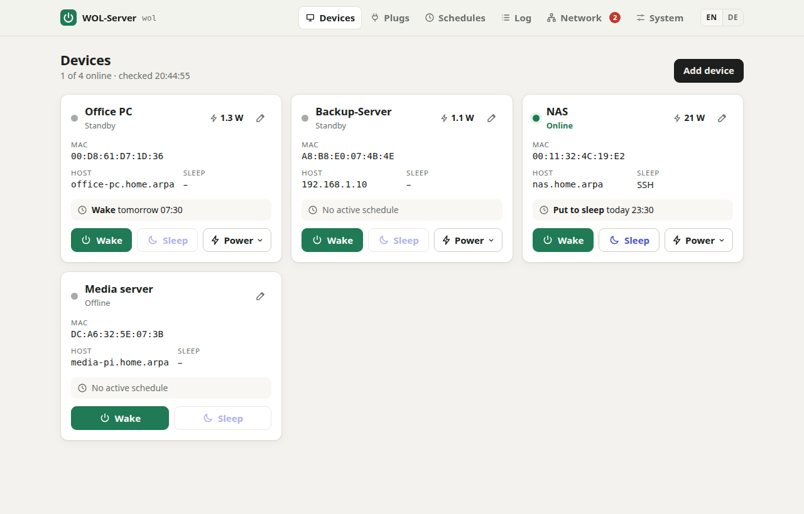
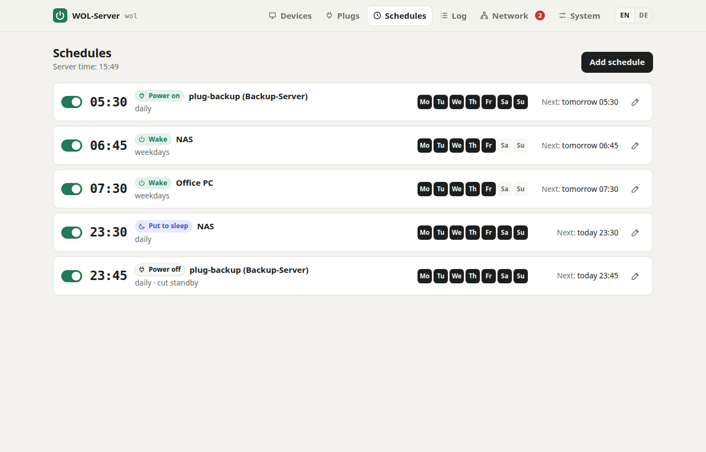
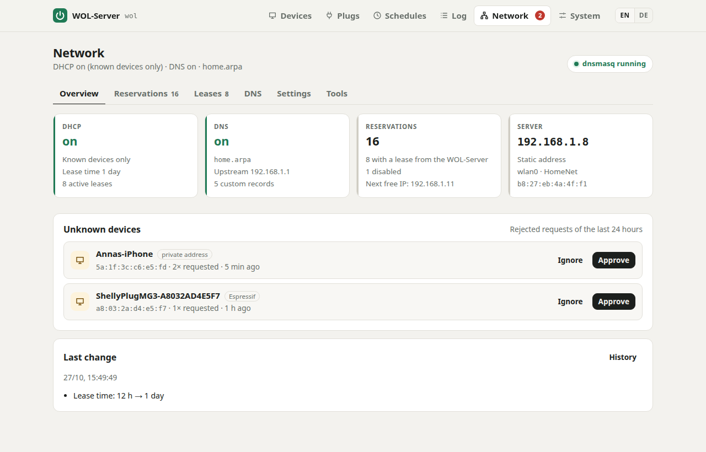
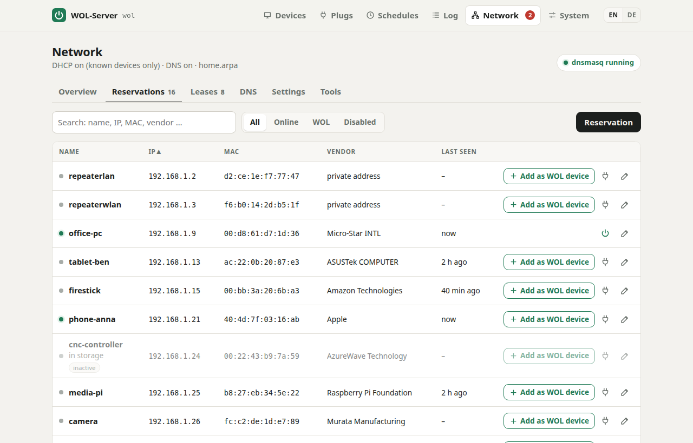
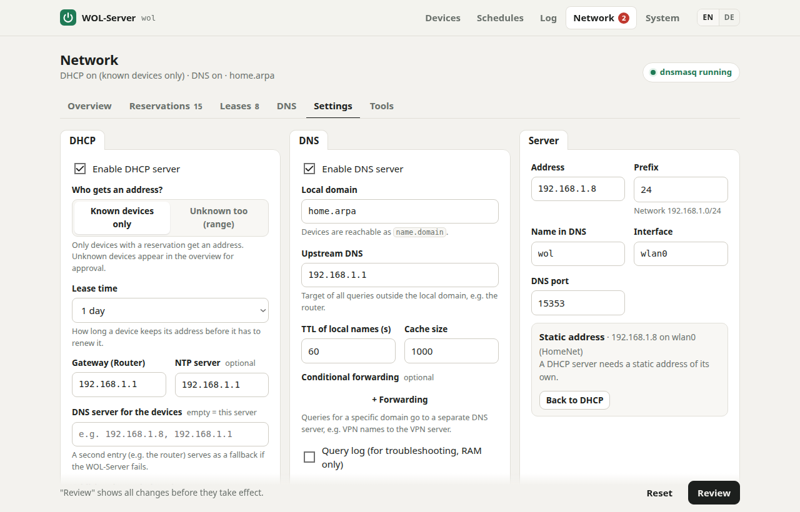
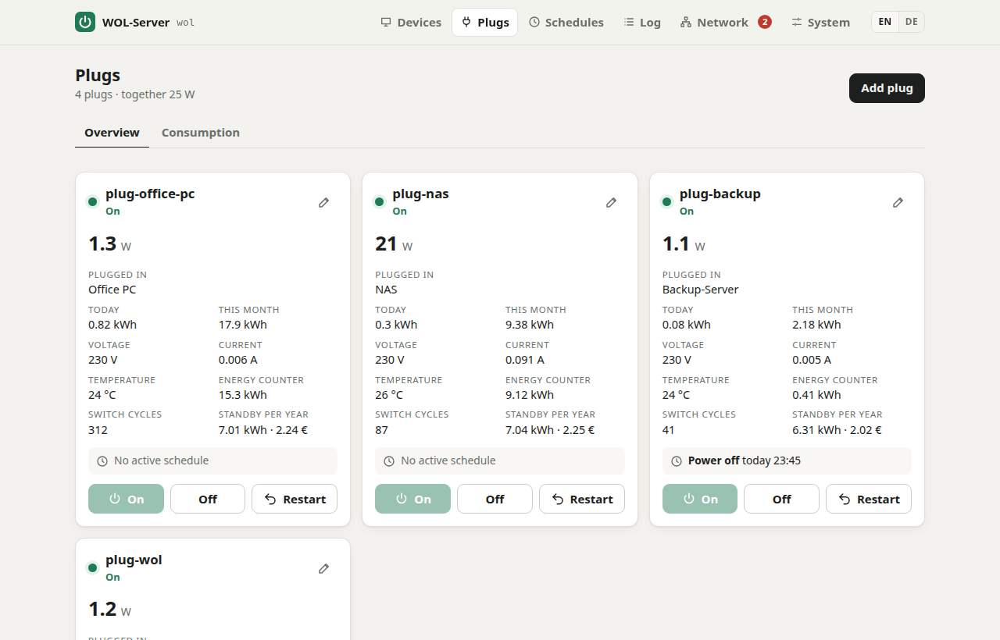
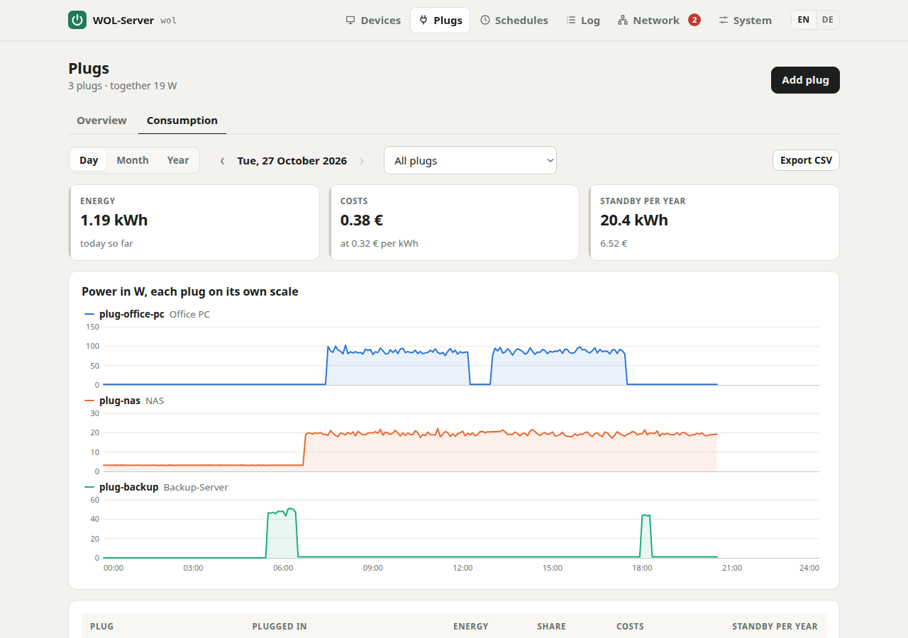
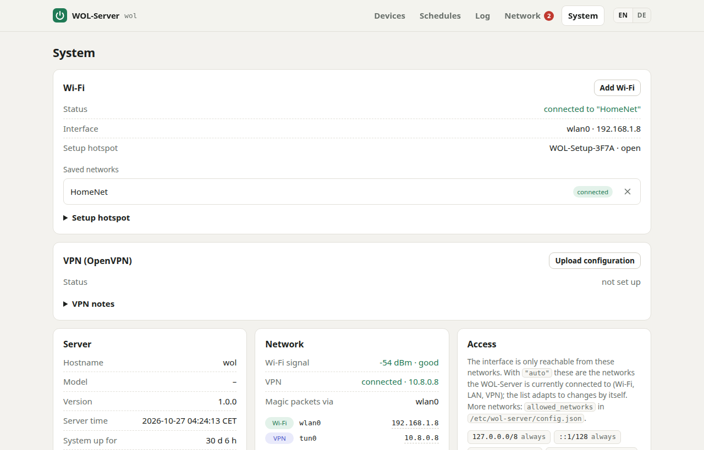
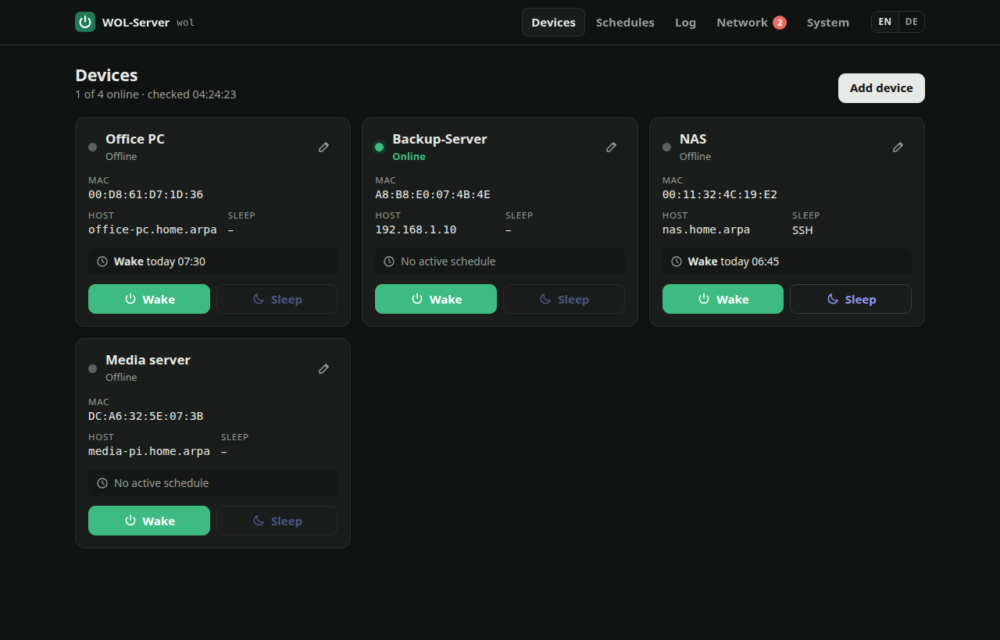
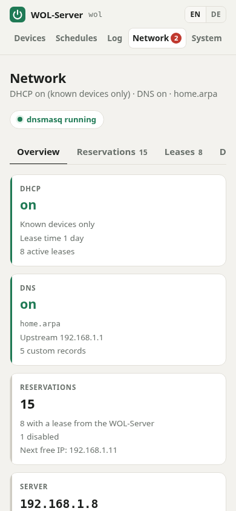

# WOL-Server on the Raspberry Pi Zero W

**English** · [Deutsch](README.de.md)

> **WOL-Server** – the Low-Power Intranet Network Swiss Army Knife on a Raspberry Pi Zero W

**Producer:** Thorsten Schnebeck (author, copyright and responsibility) · **Code generator:** Claude (Anthropic)

A small home network hub on a Raspberry Pi Zero W that runs around the clock on less than one watt. It wakes
computers on the home network or puts them to sleep (manually or on a schedule, from the intranet and over VPN)
and can optionally take over DHCP and DNS for the whole network. Everything through a web GUI, with no
dependencies other than Python 3.

<p align="center">
  
</p>

- **Device management:** name, MAC, host/IP, broadcast address, WOL port, sleep method
- **Wake** via magic packet, **put to sleep** via SSH command, HTTP request or Sleep-on-LAN
- **Schedules:** wake or sleep per device at a given time on selected weekdays
- **Online status** (ICMP ping or TCP probe; also detects Windows PCs behind an ICMP firewall)
- **Log** of all manual and scheduled actions
- **Shared devices:** clients request a device through the API (LAN or VPN) and send heartbeats; it sleeps only
  when the last request is done, e.g. a backup server serving several backup clients
- **OpenVPN client on the Pi:** The Pi is reachable over the VPN without port forwarding at home (even behind
  DS-Lite/CGNAT)
- **Wi-Fi-only operation:** power save off, Wi-Fi watchdog, hardware watchdog; magic packets always go out on
  Wi-Fi, never into the tunnel
- **Appliance-style setup hotspot:** If the Pi finds no known Wi-Fi network, it opens its own hotspot with a setup
  page. Switching Wi-Fi networks works without Imager, keyboard or SD card.
- **Status LED:** The green LED shows whether setup is running, the hotspot is active or the network is missing.
- **Wireless plugs (Shelly Gen2+, optional):** switch and measure consumers; energy per hour, day, month and
  year with costs and the standby share; a plug linked to a device wakes it by power, cuts it after sleep and
  shows whether it really runs; alerts for overheating, welded relays and more; plugs are secured from the GUI
- **DHCP and DNS for the home network (optional):** dnsmasq, managed in the *Network* tab. Every device is
  automatically reachable by its name; reservations, custom DNS records, approving unknown devices with one
  click, import from the old ISC dhcpd, history with restore.
- **HTTPS with a Let's Encrypt certificate:** A public web server renews the certificate, the Pi fetches it over
  the VPN; HTTP redirects to HTTPS automatically.
- **Access from LAN/VPN only:** The allowlist automatically follows the Pi's own networks (Wi-Fi, VPN tunnel);
  password login, CSRF protection, hardened systemd service
- **Troubleshooting with a card reader:** Setup, boot and trace logs are written to the boot partition
- **English and German GUI:** a small switcher in the header; the browser language is the default
- **No dependencies** other than Python 3 (standard library): no pip, no Node, no database server (the energy log uses SQLite from the standard library), no CDN

```
 Phone on the go ──► OpenVPN server ◄──(tun0, outbound)── Pi Zero W ──(wlan0)──► Wi-Fi router ──(LAN)──► PC / NAS
 Laptop at home ─────────────(Wi-Fi/LAN)──────────────────►   :80                  Magic packet (broadcast)
                                                                └──(SSH / HTTP / Sleep-on-LAN)──► put to sleep
```

Why a Pi? Magic packets are layer 2 broadcasts and do not pass through a VPN tunnel. The Pi sits on the home
network and sends the packet there on your behalf. To make this possible, it builds the OpenVPN tunnel to the
outside itself.

### Hardware and power consumption in continuous operation

Designed for the **Raspberry Pi Zero W** (512 MB RAM, single core, Wi-Fi only). It is enough for everything here,
because the server gets by with the Python standard library, does not poll when idle and keeps logs in RAM only.

| | Power | per year (24/7) | Cost at 35 ct/kWh |
|---|---|---|---|
| Pi Zero W idle, Wi-Fi connected, HDMI and Bluetooth off | approx. 0.4–0.7 W | approx. 3.5–6 kWh | approx. €1.20–2.10 |
| for comparison: small PC or NAS running 24/7 | 15–30 W | 130–260 kWh | €46–92 |

The figures for the Zero are typical values (approx. 80–140 mA at 5 V), not our own measurements. `lowpower.sh`
turns off HDMI (approx. 25 mA), Bluetooth and audio. Wi-Fi power save deliberately stays off, because
reachability comes first; `over_voltage=2` (for stability under load, see [Saving memory](#saving-memory-lowmemsh))
costs a little more. A stable power supply with at least 1.2 A is important: on the Zero W, undervoltage shows up
as random crashes.

### Screenshots

| | |
|---|---|
|  |  |
| **Schedules** per device, on weekdays or daily | **Network:** DHCP, DNS, reservations and unknown devices at a glance |
|  |  |
| **Reservations** with vendor, status and Wake directly from the list | **Settings** for DHCP, DNS and server, with Review before Apply |
|  |  |
| **Plugs:** power, energy, temperature, switching with safety checks | **Consumption** per hour, day, month and year, each plug on its own scale |
|  |  |
| **System:** Wi-Fi, VPN, access, HTTPS status | **Dark theme** follows the system setting |

<p align="center">
  <br>
  <em>Works on a phone, too</em>
</p>

---

## 1. Preparing the SD card

There are two ways:
- **Option A: ready-made image.** Write the card, insert it into the Pi, done. No SSH, no keyboard, no Imager
  settings. Recommended.
- **Option B: Imager and SSH.** Install Raspberry Pi OS, then install WOL-Server over SSH.

### Option A: ready-made image (no SSH)

On a Linux PC (no root required; needs `mtools`, `xz-utils`, `fdisk` and `curl`):

```bash
cp deploy/firstboot/wol-setup.txt my-settings.txt   # edit: GUI password, hostname, Wi-Fi if needed
./deploy/make-image.sh -c my-settings.txt \
    --ovpn client.ovpn --ovpn-auth vpn-credentials.txt \
    --xz -o wol-server.img                                   # omit the VPN options if not needed
```

The script downloads the current **Raspberry Pi OS Lite (32-bit)** and verifies its checksum. It then puts
WOL-Server, the settings and, if given, the VPN configuration on the boot partition. Write the resulting
`wol-server.img.xz` to the card with any tool:
- **Raspberry Pi Imager:** choose *Use custom* and answer the question about **OS customisation with "No"**.
  Otherwise the Imager replaces the boot configuration.
- **balenaEtcher** or `xzcat wol-server.img.xz | sudo dd of=/dev/sdX bs=4M conv=fsync`

Insert the card into the Pi and power it on. On first boot the Pi sets itself up, which takes about 5–10 minutes
on the Zero W. It then reboots once (memory and power saving mode) and opens the hotspot **`WOL-Setup-XXXX`**,
through which you choose the home Wi-Fi network (see [Setting up Wi-Fi](#setting-up-and-changing-wi-fi-setup-hotspot)).
If a Wi-Fi network was entered in the settings, the Pi is reachable directly at `http://wol.local/`.
While setup is running, the green LED blinks rapidly (see [Status LED](#status-led)).

What happens on first boot (`deploy/firstboot.sh`, started by cloud-init):
- It sets hostname, time zone and Wi-Fi country, and optionally sets up maintenance access (`SSH=yes`, key via
  `--ssh-key`).
- It installs WOL-Server including the Wi-Fi safeguards and the hotspot. Raspberry Pi OS Lite ships all required
  packages, no internet connection is needed.
- It sets the GUI password from the settings.
- OpenVPN is installed automatically as soon as the Pi has internet access over Wi-Fi.
- Afterwards it deletes the settings, VPN keys and sources from the boot partition. The log is kept there as
  `wol-setup.log` (already during setup), and on the Pi at `/var/log/wol-firstboot.log`.
- If the Pi stops halfway (power failure, hang), it resumes setup on the next boot (`wol-firstboot.service`).

> **Without a Linux PC:** Write the official Raspberry Pi OS Lite (32-bit) without OS customisation. Then copy
> to the boot partition (`bootfs`): the contents of `deploy/firstboot/` (`user-data`, `userconf.txt`,
> `wol-setup.txt` to edit) and this project directory as a folder named **`wol-server`**. Optionally add
> `openvpn.ovpn`, `openvpn.auth` and `ssh_authorized_keys`.

**Caution:** Until first boot, the image and the card contain passwords and possibly the private VPN key.
Do not share the image, and delete it after writing.

### Option B: Imager and SSH

With the **Raspberry Pi Imager**:

1. Device: *Raspberry Pi Zero* · Operating system: **Raspberry Pi OS Lite (32-bit)**
   (the Zero W has an ARMv6 CPU; 64-bit only runs on the Zero 2 W)
2. Under "Edit settings":
   - Hostname, e.g. `wol` (the GUI is then reachable at `http://wol.local/`)
   - User name and password
   - Wi-Fi (SSID, password, country `DE`): only needed for the initial installation over SSH, see below
   - Time zone `Europe/Berlin`. **Important for schedules**, because they run in the Pi's time zone.
   - Under "Services": **enable SSH**
3. Write the card, insert it into the Pi, boot (the first boot takes a few minutes).

The Imager is only needed this one time. After installation, the Pi sets up new or changed Wi-Fi networks through
its **setup hotspot** (see [Setting up Wi-Fi](#setting-up-and-changing-wi-fi-setup-hotspot)).

> **Tip:** Give the Pi a fixed IP address in your router (e.g. FRITZ!Box: *Home Network → Network → device →
> "Always assign this network device the same IPv4 address"*).

## 2. Installation (option B)

From your own computer:

```bash
scp -r WOL-Server <user>@wol.local:~/
ssh <user>@wol.local
cd ~/WOL-Server
sudo ./deploy/install.sh --openvpn ~/client.ovpn   # asks for the GUI password (and VPN credentials if needed)
sudo ./deploy/lowmem.sh                            # optional, recommended
sudo ./deploy/lowpower.sh                          # optional, recommended - then: sudo reboot
```

`install.sh` creates the system user `wol`, copies the program to `/opt/wol-server`, writes
`/etc/wol-server/config.json`, generates an SSH key and starts the `wol-server` service.
It also sets up the Wi-Fi safeguards (`wlan-setup.sh`) and the setup hotspot (`hotspot-setup.sh`), both described
below, and with `--openvpn` the VPN client (`openvpn-setup.sh`, see section 4).
The script can safely be run again; this is also how **updates** are installed.
Data and configuration are preserved.

Options:
- `--port 8080`: different port
- `--no-password`: do not ask for a password
- `--openvpn <file.ovpn>`: set up the OpenVPN client
- `--country AT`: Wi-Fi country (default `DE`), important for permitted channels and transmit power
- `--no-wlan-setup`: without Wi-Fi safeguards
- `--no-hotspot`: without setup hotspot

### Wi-Fi operation: `wlan-setup.sh`

The Zero W only has Wi-Fi. To keep the server reliably reachable anyway, `install.sh` sets up the following
automatically. It can also be run on its own with `sudo ./deploy/wlan-setup.sh`.

| Measure | Effect |
|---|---|
| Wi-Fi power save off | Without this setting the Zero misses incoming connections and broadcasts. Costs only a few mA. |
| Fixed MAC address | The Pi joins every Wi-Fi network with its hardware MAC, never a random one. This keeps DHCP reservations and router rules working. |
| Wi-Fi watchdog (timer, every minute) | Pings the gateway. After 3 failures Wi-Fi is reconnected; after 30 min without network the Pi reboots (at the earliest 1 h after boot). While the setup hotspot is running, the watchdog stays out of the way. Configurable in `/etc/default/wol-wlan-watchdog`. |
| Hardware watchdog | Reboots the Pi if the system hangs completely |

The watchdog logs to the journal: `journalctl -t wlan-watchdog`.

### Setting up and changing Wi-Fi: setup hotspot

New router, changed Wi-Fi password, moving house: If the Pi cannot find any of its saved Wi-Fi networks, it opens
its own hotspot after 5 minutes. If no Wi-Fi network is saved at all, this happens 30 seconds after boot.

1. Connect your phone or laptop to the Wi-Fi network **`WOL-Setup-XXXX`**. `XXXX` are the last digits of the
   Wi-Fi MAC address.
2. The setup page opens by itself (captive portal). If not, open **`http://10.42.0.1/`**.
3. Log in (if a GUI password is set), choose the Wi-Fi network from the list, enter the password, *Connect*.
   Optionally *Static IP address*: address with prefix (e.g. `192.168.1.8/24`), gateway and DNS server. This is
   required if WOL-Server later becomes the DHCP server itself, and also works on a network without DHCP.
4. The Pi stops the hotspot and connects. The GUI is then reachable on the home network again, e.g. at
   `http://wol.local/` or the static address. If the connection fails, for example because the password is wrong,
   the hotspot reopens after about a minute and the page shows the error.

In normal operation, *System → Wi-Fi* manages the saved networks. Additional Wi-Fi networks can be added in
advance, for example before moving house. The Pi uses them automatically as soon as the current Wi-Fi network is
no longer reachable.

Good to know:
- The Zero W has only a single 2.4 GHz radio. Hotspot and Wi-Fi client do **not work at the same time**. While the
  hotspot is running, the Pi therefore briefly turns it off every 5 minutes and looks for the saved Wi-Fi
  networks. This does not happen while a device is connected to the hotspot or the setup page is in use.
- The Wi-Fi list in the hotspot comes from the scan right before it started, because the chip cannot scan in
  hotspot mode. If a network is missing, enter its name manually.
- **Security:** The hotspot is open at first, so that initial setup works without prior knowledge. The GUI is
  protected by its password. A WPA2 password can be set under *System → Wi-Fi → Setup hotspot*. Hotspot clients
  may always use the GUI, even if `10.42.0.0/24` is not in `allowed_networks`.
- While the hotspot is running, the Pi is not on the home network. Schedules that fall due are not executed and
  are logged as errors.
- Under the hood: A separate service `wol-wifi` controls the hotspot as root via NetworkManager. The web server
  talks to it over a Unix socket and needs no network privileges itself. To set it up on its own:
  `sudo ./deploy/hotspot-setup.sh --country DE`.

### Status LED

The Zero has no screen, so the green activity LED shows the state:

| LED | Meaning |
|---|---|
| rapid blinking | first-boot setup is running, or the Pi is connecting to a Wi-Fi network |
| heartbeat (double flash) | setup hotspot `WOL-Setup-XXXX` is active: connect your phone to it |
| slow blinking (1 s on, 1 s off) | no network; the hotspot starts after 5 minutes |
| normal flickering on SD access | on Wi-Fi, all fine (with `lowpower.sh --led-off`: off) |

The patterns run in the kernel and cost no CPU. Turn them off with `"status_led": false` in the configuration.

**Handing it on as a finished device or creating an image:** After installation, delete the saved Wi-Fi networks
(`sudo nmcli connection delete <name>`, names via `nmcli connection show`) and shut the Pi down. On the next boot
it opens the hotspot immediately. In this state the SD card can also be saved as an image for further devices.

### Saving memory: `lowmem.sh`

Tunes Raspberry Pi OS for the 512 MB of the Zero W. With the image, it runs at the end of setup; the changes take
effect after the subsequent reboot.

| Measure | Effect |
|---|---|
| KMS graphics driver off | fewer drivers and less graphics memory |
| `over_voltage=2` (Zero W only) | stable operation under load, see below |
| Camera, video codec and audio drivers blacklisted, camera/display detection off | fewer kernel modules |
| Swap as zram only (`/etc/rpi/swap.conf.d`), `vm.swappiness=100`, `vm.page-cluster=0` | no swap file on the SD card |
| `apt-daily`, `man-db` and other daily timers off | no daily apt runs, which need a lot of RAM and CPU on the Zero |

`gpu_mem` deliberately stays at the default (64 MB). With `gpu_mem=16` the firmware overflows and overwrites
memory: the Zero W crashed under load with random kernel oopses ([forum][gpu16]). On Trixie, camera and codec
buffers live in CMA anyway, so the setting hardly gains anything any more. Independently of that, some Zero W
boards are not stable with the 6.x kernels at standard voltage under memory and card load
([raspberrypi/linux#5572][ov]); `over_voltage=2` fixes this (without `force_turbo` the warranty remains intact).

[gpu16]: https://forums.raspberrypi.com/viewtopic.php?t=316155
[ov]: https://github.com/raspberrypi/linux/issues/5572

A custom kernel is not needed: it would save only a few MB and would no longer receive updates via apt.
AppArmor and IPv6 stay enabled. The Zero's firmware disables memory cgroups itself (`cgroup_disable=memory`),
so `MemoryMax` of the services has no effect there. The kernel parameters in `cmdline.txt` remain unchanged.
`config.txt` is backed up first (`config.txt.bak-<date>`).

### Saving power: `lowpower.sh`

| Measure | Effect |
|---|---|
| HDMI off | approx. 25 mA less |
| Bluetooth off (`disable-bt`, `hciuart`, `bluetooth`) | less power, fewer services |
| `triggerhappy`, `ModemManager` off | fewer background processes |
| Journal in RAM only, SD swap off | spares the SD card |
| `--led-off` | green activity LED off in normal operation (status patterns remain) |

`config.txt` is backed up first (`config.txt.bak-<date>`). With `--keep-hdmi` / `--keep-bluetooth`
individual measures can be skipped.

## 3. Preparing the target devices

### Enabling Wake-on-LAN

- **BIOS/UEFI:** enable "Wake on LAN", "Power On by PCI-E" or similar, disable "ErP/EuP".
- **Linux:** `sudo ethtool -s eth0 wol g`, permanently with NetworkManager:
  `nmcli connection modify "<connection>" 802-3-ethernet.wake-on-lan magic`
- **Windows:** Device Manager → Network adapters → Properties
  - Power Management: "Allow this device to wake the computer" and "Only allow a magic packet …"
  - Advanced: "Wake on Magic Packet" = Enabled
  - To wake from the *shut down* state, **disable Fast Startup**
    (Power Options → "Choose what the power buttons do")
- The target device should be connected **by cable**, because only a few devices support WOL over Wi-Fi.

**The Pi on Wi-Fi:** The router or access point forwards the broadcast from Wi-Fi to the wired network. For this:
- The Pi must be on the **same network** as the target devices, so **not on the guest Wi-Fi**.
- **Client isolation** must not be active on the access point.
- Mesh repeaters (FRITZ!Repeater and similar) normally forward broadcasts.
- Wi-Fi broadcasts are not acknowledged; the server therefore sends every magic packet 5 times.
- The GUI shows the signal strength under *System → Network* (better than approx. −70 dBm is good).

If the packet does not arrive, enter your own network's broadcast address in the GUI
(e.g. `192.168.178.255` instead of `255.255.255.255`).

### Putting devices to sleep

Wake-on-LAN has no notion of "sleep". WOL-Server offers three ways:

**SSH** (recommended for Linux, macOS, Windows with OpenSSH server). Add the public key from
*System → SSH key for putting devices to sleep* on the target:

```bash
# Linux target device, as the user entered in the GUI:
echo 'ssh-ed25519 AAAA… wol-server@wol' >> ~/.ssh/authorized_keys
echo "$USER ALL=(root) NOPASSWD: /usr/bin/systemctl suspend, /usr/bin/systemctl poweroff" \
  | sudo tee /etc/sudoers.d/wol-server
```

Command in the GUI: `sudo systemctl suspend`.

As root, a key can be tied to exactly one command instead. [deploy/wol-sleep.sh](deploy/wol-sleep.sh) is such a
command: it puts the machine to sleep (`suspend`, or `poweroff` for firmware without S3), refuses while work is
announced with an inhibitor, while a given service runs or while someone works at an unlocked session, and holds the
machine awake on `hold` (see *Keep awake while requested*). The three settings are at the top of the script.

```bash
# on the target, as root
install -m 755 wol-sleep.sh /usr/local/sbin/wol-sleep

# /root/.ssh/authorized_keys on the target: only from the Pi, only this command
from="192.168.178.20",command="/usr/local/sbin/wol-sleep",no-port-forwarding,no-X11-forwarding,no-agent-forwarding,no-pty ssh-ed25519 AAAA… wol-server@wol
```

The command in the GUI then does not matter; enter the script's path so the GUI shows what runs. A refusal
appears in the GUI and in the log. A device that answers neither ping nor the TCP probes is asleep or off already:
the WOL-Server sends no sleep command then and logs "Already off or asleep" - for the button, schedules and
requests alike. Check refusals by the state of the machine (inhibitors, units, sessions),
never by text on command lines: `pgrep -f rsync` also matches an administrator's shell that only mentions it.

Windows: install *OpenSSH Server* under "Optional features". For administrator accounts the key belongs in
`C:\ProgramData\ssh\administrators_authorized_keys`. Command: `shutdown /h` (hibernate) or
`rundll32.exe powrprof.dll,SetSuspendState 0,1,0` (standby, if hibernation is disabled).

On the first connection the server remembers the target's host key (`accept-new`).

**HTTP:** Calls a URL (GET/POST/PUT, optionally with a body). This fits e.g. Home Assistant, a NAS API or your
own sleep endpoint.

**Sleep-on-LAN:** Sends a magic packet with the MAC reversed. This requires a matching service on the target,
e.g. [sleep-on-lan](https://github.com/SR-G/sleep-on-lan) (Windows/Linux).

## 4. Access over VPN (OpenVPN client on the Pi)

The Pi connects as an **OpenVPN client** to an OpenVPN server, e.g. on a VPS, in the router or on a NAS. Other
VPN participants (phone, laptop) then reach it at its VPN address. Because the tunnel is built from the Pi to the
outside, no port forwarding is needed at home; this also works behind DS-Lite/CGNAT.

**Via the web GUI:** *System → VPN → Upload configuration*, choose the `.ovpn` file, enter user name and password
if needed. The Pi installs OpenVPN (needs internet, takes a few minutes on the Zero), sets up the client and
turns it on. The GUI then shows status, VPN address and server; turning it on/off and removing it are also done
there.
- The file must contain the certificates inline (`<ca>`, `<cert>`, `<key>`, `<tls-auth>` …).
- The Pi rejects options that run programs or write files (`up`, `down`, `script-security`, `plugin`, `log`,
  `management` …), because OpenVPN runs as root.
- Under the hood: The GUI hands the file to the root service `wol-wifi`, which validates it and writes a job.
  The job is executed by `wol-vpn.service` (started by `wol-vpn.path`), which calls `openvpn-setup.sh`.

The same works on the command line:

```bash
sudo ./deploy/openvpn-setup.sh ~/client.ovpn      # or directly: install.sh --openvpn ~/client.ovpn
```

The script does the following:
- installs `openvpn` and stores the configuration as `/etc/openvpn/client/wol.conf` (mode 0600)
- asks for user name and password if the configuration uses `auth-user-pass`; the credentials are stored in
  `/etc/openvpn/client/wol.auth`, because OpenVPN cannot prompt when headless
- copies referenced files (`ca ca.crt` …) along; configurations with inline certificates work as they are
- ensures unlimited reconnection after Wi-Fi or server outages (`connect-retry`, `ping-restart`,
  systemd `Restart=always`)
- **ignores `redirect-gateway` and pushed DNS servers.** The Pi should only be *reachable* over the VPN, not send
  all its traffic through the tunnel. This saves CPU on the single-core Zero. `--allow-redirect-gateway` turns
  this off. Magic packets go out on Wi-Fi in any case, because the server binds them to the Wi-Fi address.
- shows the URL in the VPN at the end, e.g. `http://10.8.0.6/`

### External OpenVPN server (VPS or similar)

The Pi and the phone/laptop are both **clients** of the same server. For them to reach each other, the server
configuration (e.g. `/etc/openvpn/server/server.conf`) needs these settings:

```
topology subnet
server 10.8.0.0 255.255.255.0
client-to-client                 # clients may talk to each other (without kernel forwarding)
client-config-dir /etc/openvpn/ccd
keepalive 10 60                  # detect dropouts (Wi-Fi!) quickly, client reconnects
```

A fixed address for the Pi, so that the URL stays stable. The file name is the **common name** of the Pi
certificate or, with `username-as-common-name`, the VPN user name:

```
# /etc/openvpn/ccd/wol-pi
ifconfig-push 10.8.0.6 255.255.255.0
```

Then restart the server. The GUI is then reachable from every VPN client at `http://10.8.0.6/`.

Notes:
- **Every client needs its own certificate** or its own user. With shared certificates (`duplicate-cn`) the fixed
  address does not work reliably.
- **Commercial VPN services** (NordVPN, ProtonVPN etc.) are not suitable: they isolate clients from each other,
  so the Pi would not be reachable through them.
- Over the VPN the Pi can only offer itself. The devices on the home network are not directly reachable over the
  VPN, and WOL-Server does not need that either. If you want it anyway, you need `route`/`iroute` for the home
  network on the server and IP forwarding with NAT on the Pi. That is not part of this project.
- The VPN subnet must not overlap with the home network or the network you are on while away (e.g. VPN
  `10.8.0.0/24`, home network `192.168.178.0/24`).
- VPS firewall: only the OpenVPN port (default UDP 1194) needs to be open.
- Revoke the Pi certificate if the SD card is lost: the keys are stored there unencrypted in
  `/etc/openvpn/client/`.

The GUI is only reachable from the networks in `allowed_networks`. The default `"auto"` allows localhost,
IPv6 link-local and the networks the Pi is currently attached to, which includes the VPN tunnel's network. The
list adapts to new addresses and VPN networks by itself. If VPN clients come from a network other than the
tunnel's (routed networks), add it in `/etc/wol-server/config.json`, e.g.
`"allowed_networks": ["auto", "10.9.0.0/24"]`, and run `sudo systemctl restart wol-server`. The GUI shows the
VPN status including the address under *System → Network*.

> The GUI deliberately speaks plain HTTP only: it is reachable exclusively from the LAN/VPN, and VPN traffic is
> encrypted. **Never expose the port to the internet via port forwarding.**

An OpenVPN client puts hardly any load on the Zero W when idle (keepalives only). The performance is easily
sufficient for the few kilobytes of the GUI.

## 5. DHCP and DNS ("Network" tab)

WOL-Server can take over DHCP and DNS for the home network, for example as a replacement for an ISC dhcpd with
BIND and Webmin. It is built on **dnsmasq**: DHCP and DNS in one process, so every device that gets an address is
immediately reachable as `name.domain`, including the reverse lookup from IP to name. Expired leases disappear
again. Background and decisions: [docs/proposal-dhcp-dns.md](docs/proposal-dhcp-dns.md).

Everything stays off until you turn it on in the GUI. `hotspot-setup.sh` (run by `install.sh`) only provides the
services.

**Usage:** *Apply* makes a change take effect immediately, e.g. for reservations and DNS records.
In *Settings*, *Review* first shows all changes; confirming with *Apply* makes them take effect.
On Apply, the Pi checks the new configuration with `dnsmasq --test`, reloads (reservations without interruption
via SIGHUP) and tests DNS. If anything fails, it restores the previous state by itself.
Import, backup and history create a **draft**. The bar at the top shows the pending changes; further changes go
into the draft until it is applied or discarded.

| Section | Contents |
|---|---|
| Overview | status, notices (e.g. "another DHCP server is responding"), **unknown devices** with *Approve* (name and next free IP prefilled, takes effect immediately) or *Ignore* |
| Reservations | MAC → IP → name, comment, enabled/disabled, custom lease time; search, filter, vendor, "last seen"; wake WOL devices directly |
| Leases | active leases with remaining time; *Reserve*, *As WOL device*, *Release* |
| DNS | test query, cache statistics, custom records (name → IP, alias, MX, SRV, TXT), query log |
| Settings | DHCP ("known devices only" mode or address range, lease time, gateway, DNS, NTP, search domains), DNS (domain, upstream, conditional forwarding), server (set static address), network boot (PXE) |
| Tools | import from `dhcpd.conf` with preview, backup as JSON, search for other DHCP servers, restart dnsmasq, history with restore, DHCP/service log, ignored devices |

**Migrating from an ISC dhcpd** (procedure with fallback in the [proposal](docs/proposal-dhcp-dns.md#6-migrating-from-10)):
1. *Settings → Server → Set static address.* A DHCP server needs a static address of its own.
2. *Tools → Import dhcpd.conf.* Names are cleaned up for DNS (`LinuxCNC_Alfa` → `linuxcnc-alfa`). The entry for
   WOL-Server itself is skipped.
3. Turn on DNS, apply and test: `dig @<pi> office-pc.home.arpa`. The clients do not notice anything yet.
4. On the old server run `systemctl disable --now isc-dhcp-server`, then *Tools → Search for other DHCP servers*
   (none may respond any more) and turn on DHCP.
5. Fallback at any time: turn off DHCP in WOL-Server, start the old server again.

**Notes:**
- The Pi rejects domains under `.local`: they are reserved for mDNS and would interfere with e.g. `wol.local`.
  `oldnet.local` can remain as an additional search domain.
- In "known devices only" mode, phones with a **private Wi-Fi address** drop out when the address changes.
  They then appear in the overview for approval.
- dnsmasq pauses automatically while the setup hotspot is active and resumes afterwards.
- Vendors for MAC addresses come from the list in the `ieee-data` package, if installed (setup tries to install it).
- Under the hood: The GUI (without root) hands structured data to `wol-wifi`, which validates it and generates the
  dnsmasq files from it. They are deployed by `wol-dns-apply.service` (started by `wol-dns-apply.path`).
  dnsmasq runs as `wol-dns.service` with its own configuration in `/etc/wol-dns/`.

## 6. Wireless plugs ("Plugs" tab)

Metering wireless plugs switch a consumer and measure what it draws. WOL-Server talks to them locally, without
a vendor cloud, and polls them once a minute in the background for the energy log and the alerts. Supported are
**Shelly plugs of generation 2 and later** (Plus, Pro, Gen3, Gen4; tested with the Plug M Gen3); further vendors
only need a driver. Background and decisions: [docs/proposal-smart-plugs.md](docs/proposal-smart-plugs.md).

**Setting up:**
1. Put the plug on the Wi-Fi (Shelly app or the plug's own access point), or let it ask the WOL-Server for an
   address: in "known devices only" mode it then appears under *Network → Overview* for approval.
2. *Plugs → Add plug* (or the plug button next to a reservation), *Detect*, enter the password if the plug has one.
3. *Edit → Security* shows what is open and secures the plug in one step: it switches off the plug's own
   access point (open on a new Shelly), Bluetooth, Matter and the vendor cloud as chosen, and sets a password
   (a random one unless you enter one; only the WOL-Server needs it, a reset of the plug removes it). Matter
   only goes off after a restart of the plug: the dialog shows "Waiting for a restart" and offers the restart.
4. Under *Plugged in*, link the plug to a device (or name what it supplies).

**Safety rules (they apply to every vendor):**
- *Off* and *Restart* ask first while the consumer draws more than its standby threshold.
- *Restart* (off, on again after 10 s) runs on the plug itself, so it switches back on even if Wi-Fi or the
  WOL-Server fail in between.
- **Never switch off:** the plug of the WOL-Server itself (*Plugged in: This WOL-Server*), of the router or a
  switch is switched on and measured, but never switched off or restarted, also not by a schedule.
- A restart of the plug is refused where its output would stay off afterwards (setting *After a power outage*).

**Linked to a device** (*Edit device → Plug*):
- **Wake via** *WOL*, *Power on* (for devices that start when the power returns, BIOS setting "AC power
  loss: power on") or *Power on, then WOL*. With the plug on and the device in standby, *Power on* runs a short
  power cycle.
- **Cut the power after "Sleep":** after *Sleep* the plug switches off once the draw has dropped to standby. Only
  for a sleep command that shuts the device down: a device in suspend to RAM would lose its unsaved work.
- The device card shows the power and opens the plug's switch from there; the status tells *Standby*, *No power*,
  *Starting or shutting down* and *Not responding* (draws power, but no answer to ping) apart.

**Consumption:** *Hour* (live, every 5 s while the view is open, with the power right now), *Day* (power curve,
each plug on its own scale), *Month* and *Year* (stacked columns). With a price per kWh, costs are shown; the
standby energy per year is estimated from the last 30 days. CSV export for every period.

**Alerts** (in the overview and the log): overtemperature, overload, over- and undervoltage reported by the plug,
temperature from 70 °C, a relay that is off while power flows (welded contacts), 80 % of the rated switching
cycles used, plug unreachable for 5 minutes.

**Notes:**
- Plugs measure poorly below about 1 W; a Shelly then shows 0 W and counts no energy. A Pi Zero on its own plug
  therefore mostly reads 0 W.
- The plug passwords stay on the server (`plugs.json`, mode 0600); the GUI never gets them back. For a Shelly the
  server does not even keep the password: after the first successful login it stores only the digest key derived
  from it (HA1, the value the plug keeps itself). That key works for this one plug only, so the file does not give
  away a password that may be in use elsewhere. Plugs saved with their password are switched over by themselves.
- The energy log is easy on the SD card: values of the running hour stay in RAM and are written once per hour.
- The plug endpoints need a GUI session; API tokens are limited to devices.

## 7. Usage

| Section | Function |
|---|---|
| **Devices** | cards with online status, next scheduled action, *Wake* / *Sleep* buttons (Wake only when the device is not online, Sleep only when it is not off); with a plug also its power and switch |
| **Plugs** | overview with power, energy, temperature and switching; consumption per hour, day, month and year (see [Wireless plugs](#6-wireless-plugs-plugs-tab)) |
| **Schedules** | time + weekdays + action (for devices and plugs); can be paused with a switch; presets "Weekdays/Weekend/Daily" |
| **Log** | the last 300 actions with result (manual / schedule) |
| **System** | Wi-Fi (status, saved networks, add, hotspot password), hostname, time, CPU temperature, Wi-Fi signal, VPN status, interfaces, allowed networks, SSH key, password |

The online status is only polled while the page is open and visible (every 10 s). If nobody is using the GUI,
the Pi sleeps until the next schedule minute.

### Command line on the Pi

```bash
sudo wol-server passwd                       # set/change the GUI password (logs out all sessions)
wol-server wake AA:BB:CC:DD:EE:FF            # send a magic packet directly
journalctl -u wol-server -f                  # logs
journalctl -u wol-wifi -f                    # Wi-Fi management / hotspot
sudo systemctl restart wol-server            # after changing config.json
```

## 8. Configuration

`/etc/wol-server/config.json`:

| Key | Default | Meaning |
|---|---|---|
| `listen` | `"::"` | address (dual-stack; falls back to `0.0.0.0` without IPv6) |
| `port` | `80` | HTTP port |
| `https_port` | `443` | HTTPS port, `0` disables HTTPS (see [HTTPS](#https-lets-encrypt-via-a-web-server)) |
| `https_host` | `""` | name in the certificate, e.g. `"wol.home.arpa"`; empty means: first name in the certificate |
| `https_redirect` | `true` | redirect HTTP to HTTPS as soon as a valid certificate is present (not in the hotspot) |
| `tls_dir` | `/etc/wol-server/tls` | certificate (`cert.pem`), key (`key.pem`) and SSH access for fetching them |
| `cert_source` | `""` | SSH target that supplies key and certificate, e.g. `"wolcert@10.1.1.3"` |
| `data_dir` | `/var/lib/wol-server` | devices, schedules, log, password hash, SSH key, plugs and energy log |
| `allowed_networks` | `["auto"]` | source networks with access; `"auto"` = localhost, IPv6 link-local and the networks of the Pi's own interfaces (Wi-Fi, LAN, VPN), continuously updated; fixed networks can be added |
| `wol_interface` | `""` (automatic) | interface for magic packets, e.g. `"wlan0"`; automatic means: the interface of the default route, VPN interfaces excluded |
| `wifi_interface` | `"wlan0"` | Wi-Fi interface for client mode and hotspot |
| `hotspot_enabled` | `true` | setup hotspot when no known Wi-Fi network is reachable |
| `hotspot_ssid` | `""` | name of the hotspot; empty means `WOL-Setup-XXXX` |
| `hotspot_delay_minutes` | `5` | minutes without Wi-Fi before the hotspot starts |
| `hotspot_retry_minutes` | `5` | interval at which the hotspot looks for the saved Wi-Fi networks |
| `wifi_socket` | `/run/wol-wifi/control.sock` | socket between the web server and `wol-wifi` |
| `status_led` | `true` | green LED as a [status indicator](#status-led) |
| `session_days` | `30` | validity of the login cookie |
| `status_cache_seconds` | `5` | cache for online checks |
| `log_level` | `INFO` | `DEBUG` logs every request |

Files:

```
/opt/wol-server/wolserver/       program (Python package incl. web/)
/etc/wol-server/config.json      configuration
/var/lib/wol-server/data.json    devices, schedules, log (written atomically)
/var/lib/wol-server/auth.json    password hash (PBKDF2) + cookie secret, mode 0600
/var/lib/wol-server/.ssh/        SSH key and known_hosts for putting devices to sleep
/var/lib/wol-server/plugs.json   plugs incl. their keys (or passwords), price per kWh, mode 0600
/var/lib/wol-server/energy.db    energy log (SQLite, one row per plug and hour)
/var/lib/wol-server/requests.json   open requests and remembered sleeps
/etc/wol-server/tls/             HTTPS: cert.pem, key.pem, fetch_key (fetching), known_hosts (web server)
/etc/openvpn/client/wol.conf     OpenVPN client (service openvpn-client@wol)
/etc/default/wol-wlan-watchdog   settings of the Wi-Fi watchdog
/var/lib/wol-wifi/hotspot.json   hotspot password (root only)
/var/lib/wol-wifi/vpn/           uploaded VPN configuration, jobs and their results (root only)
/var/lib/wol-wifi/dns/           DHCP/DNS: active state, draft, history, jobs (root only)
/etc/wol-dns/                    generated dnsmasq configuration (do not edit by hand)
/var/lib/wol-dns/                leases and lease events from dnsmasq
/var/log/wol-firstboot.log       log of the first-boot setup (option A)
/opt/wol-server/deploy/          scripts for later changes (openvpn-setup.sh, lowmem.sh, lowpower.sh, …)
/etc/NetworkManager/system-connections/   saved Wi-Fi networks (NetworkManager)
/etc/NetworkManager/dnsmasq-shared.d/60-wol-server-captive.conf   DNS redirection in the hotspot
```

**Backup:** back up `/var/lib/wol-server/`; additionally, DHCP/DNS under *Network → Tools → Backup*.

### HTTPS (Let's Encrypt via a web server)

The Pi is not reachable from the internet and therefore cannot obtain a Let's Encrypt certificate itself. A public
web server does this instead, with the name (e.g. `wol.home.arpa`) publicly pointing to it. The Pi fetches
key and certificate daily via SSH over the VPN (`wol-cert.timer`) and loads them without a restart.

On the web server (Apache, certbot):

1. A vHost on port 80 for the name that only serves `/.well-known/acme-challenge/` from a webroot.
2. `certbot certonly --webroot -w <webroot> -d <name> --key-type ecdsa --deploy-hook <hook>`; the hook writes
   `privkey.pem` and `fullchain.pem` one after the other into a single file that only a dedicated user may read.
3. That user's `~/.ssh/authorized_keys` contains the Pi's key `/etc/wol-server/tls/fetch_key.pub`:
   `restrict,from="10.1.1.0/24",command="cat <bundle>" ssh-ed25519 …`

On the Pi: set `cert_source` and `https_host` in `config.json`, add the web server's host key to
`/etc/wol-server/tls/known_hosts` (`<vpn-address> ssh-ed25519 …`), then run `sudo systemctl start wol-cert`.
The fetch only accepts certificates that match the key, are issued for `https_host` and are valid for at least two
more days. For the redirect to work, the name must point to the Pi on the home network (internal DNS).

## 9. Technical details

- **Scheduler:** It wakes up once per minute. The Zero has no real-time clock: if the clock jumps forward via NTP
  after boot, at most the last 10 minutes are caught up. Backward jumps and the repeated hour at the DST change do
  not trigger anything twice.
- **Magic packets and VPN:** If a VPN server pushes `redirect-gateway def1`, `0.0.0.0/1` and `128.0.0.0/1` belong
  to `tun0`, and a broadcast to `255.255.255.255` would end up in the tunnel. The server therefore binds the socket
  to the address of the Wi-Fi/LAN interface. Linux then sends a limited broadcast out through exactly that
  interface. The log shows which interface was used.
- **Online check:** ICMP echo via unprivileged sockets (for this, `install.sh` sets `net.ipv4.ping_group_range`).
  If the device does not answer, TCP probes on 22/445/3389/80/443/139 follow. A "connection refused" also means:
  the device is on.
- **Security:**
  - network allowlist
  - PBKDF2 password hash and HMAC-signed `HttpOnly`/`SameSite=Strict` cookies
  - login brute-force throttling
  - CSRF protection via a mandatory header
  - strict Content Security Policy
  - input validation (including against SSH option injection)
  - the service runs as an unprivileged user with `ProtectSystem=strict`, `NoNewPrivileges` and much more
- **Resources:** one Python process, approx. 15–20 MB RAM, practically 0 % CPU when idle.

### API

All endpoints return JSON. Write requests from the browser require the header `X-Requested-With: wol-server`.

#### Scripts: API tokens

For scripts, create a token under *System → API tokens for scripts*. It is shown only once and can be revoked
there at any time. A token may only list devices, query their status, wake them, put them to sleep and request
them (see below); it cannot change settings. The device can be given by ID or by name (case-insensitive). `?wait=SECONDS`
(at most 300) keeps the answer back until the device answers (wake) or is gone (sleep); the device needs a
host or IP address for this. The result: HTTP 200 when done, 504 on timeout. Each action appears in the log
as `API: <token name>`.

Example: a backup script wakes the backup server first and puts it to sleep afterwards.

```bash
#!/bin/sh
WOL=https://wol.home.arpa
AUTH="Authorization: Bearer $(cat ~/.config/wol-token)"   # token from System → API tokens

curl -fsS -X POST -H "$AUTH" "$WOL/api/devices/backup-server/wake?wait=180" || exit 1
rsync -a /home/ backup-server:/srv/backup/home/
curl -fsS -X POST -H "$AUTH" "$WOL/api/devices/backup-server/sleep"
```

#### Several clients: requests

If several clients use one device, such as backup clients and a backup server, none of them should put it to
sleep on its own: the first one done would cut off the others. Instead each client **requests** the device and
the WOL-Server puts it to sleep only when the last request is done. Background: [docs/proposal-device-requests.md](docs/proposal-device-requests.md).

```bash
#!/bin/sh
WOL=https://wol.home.arpa
AUTH="Authorization: Bearer $(cat ~/.config/wol-token)"
DEV=$WOL/api/devices/backup-server

# Request: wakes the device if needed and answers once it is online (201). The answer carries the request id
# also when waking fails (502) or the device does not come up in time (504); the script then ends it again.
RES=$(curl -sS -X POST -H "$AUTH" -d '{"client": "laptop"}' "$DEV/requests?wait=300") || exit 1
ID=$(printf '%s' "$RES" | jq -r '.id // empty')
[ -n "$ID" ] || { printf '%s\n' "$RES" >&2; exit 1; }
if [ "$(printf '%s' "$RES" | jq -r .online)" != true ]; then
    curl -sS -X DELETE -H "$AUTH" "$DEV/requests/$ID" >/dev/null
    printf '%s\n' "$RES" >&2; exit 1
fi
# Heartbeat every 5 minutes while the backup runs (a request without heartbeat expires after 15 minutes)
( while sleep 300; do curl -fs -X PUT -H "$AUTH" "$DEV/requests/$ID" >/dev/null || break; done ) 2>/dev/null & HB=$!
rsync -a /home/ backup-server:/srv/backup/home/; rc=$?
pkill -P $HB  # ends the loop: stops its sleep (or curl)
# Done, and asking for sleep: it runs 2 minutes after the last open request, unless the device is requested again
curl -fsS -X DELETE -H "$AUTH" "$DEV/requests/$ID?then=sleep"
exit $rc
```

The example needs `curl` and `jq`. [snapshot-backup](https://github.com/schnebeck/snapshot-backup) (19.0 or
later) does all of this by itself with `WOL_SERVER_URL`, `WOL_SERVER_TOKEN` and `WOL_DEVICES` in its config.

- `client` is the name shown on the device card and in the log; with a token it defaults to the token's name.
- `ttl` (seconds) sets how long a request lives without a heartbeat: 60 s to 7 days, default 900, `0` = until
  released. Its total lifetime has no limit: as long as heartbeats come, a request lives for days, e.g. for a long
  job on the device itself.
- Answers:
  - `POST …/requests`: 201 with `id`, `client`, `ttl`, `expires` (Unix time, `null` for `ttl` 0), `online` and
    `woken` (`true` if the device did not answer and this request woke it; a client can then ask for sleep
    only for a device it woke, and one that someone switched on stays on).
    The request also stays open on 502 and 504.
  - `PUT …/requests/<id>`: 200 with the new `expires`; 404 if the request has expired or was ended.
  - `DELETE …/requests/<id>`: 200 with `sleep` (`"pending"` or `null`), `waiting_for` (clients still holding
    the device) and `sleep_at`.
  - `GET …/requests` lists the open requests and a remembered sleep; `GET /api/status` contains them for all
    devices under `requests`.
- `POST …/sleep?when=idle` asks for sleep without holding a request: at once if nothing is open (200), otherwise
  2 minutes after the last request is done (202). `DELETE …/sleep` takes that back.
- While requests are open, a sleep schedule waits for the last one, *Sleep* and a plain `POST …/sleep` ask first
  (409, `?force=1` puts the device to sleep anyway), and the device's plug is not switched off by a schedule.
- The device card shows "In use: …"; *Details* lists every request (last heartbeat, expiry) and can end it. A
  token can only renew and end its own requests; the GUI can end any.
- Requests survive a restart of the WOL-Server; afterwards every request has one `ttl` for its next heartbeat.

#### Other jobs

Requests are not tied to backups: any job that needs a device for a while can hold one — a central
update, a long computation, a copy. With its own token and a `client` name that says what it is:

```bash
ID=$(curl -fsS -X POST -H "$AUTH" -d '{"client": "updates", "ttl": 1800}' "$WOL/api/devices/aida/requests?wait=300" | jq -r .id)
ssh root@aida 'systemd-inhibit --what=shutdown:sleep --who=updates --why="apt full-upgrade" apt-get -y full-upgrade'
curl -fsS -X DELETE -H "$AUTH" "$WOL/api/devices/aida/requests/$ID"
```

The request keeps the WOL-Server from putting the device to sleep, also in the gaps between the
steps of a job. On the device itself, `systemd-inhibit` announces the work to the system: a sleep
command that respects inhibitors — the forced command the WOL-Server's key runs, for example —
can refuse and name the job, even when *Sleep* is forced or the job holds no request. Such a
command should refuse on every inhibitor in `block` mode for `sleep` (or `shutdown` for a device
that is switched off) and ignore the `delay` ones that desktops and NetworkManager hold all the
time. [snapshot-backup](https://github.com/schnebeck/snapshot-backup) does both: requests on the
WOL-Server, inhibitors on the backup server (19.5 and later).

#### Keep awake while requested

A request binds the WOL-Server, not the device: its own power management (a desktop's idle timer, logind) may
still put it to sleep. For a device with the SSH sleep method, *Keep awake while requested* closes that gap. While a
request is open and the device answers, the WOL-Server holds an inhibitor on it over SSH:

```sh
systemd-inhibit --what=sleep:idle --who=WOL-Server --why="Requested via the WOL-Server" --mode=block cat
```

It holds for as long as the connection is open and goes when the last request is done - or when the WOL-Server
stops or the network breaks, so no device stays awake for good. Before every sleep the WOL-Server lets go first. A
broken hold (the device rebooted) is tried again once a minute; the device card says "held on the device".

If the WOL-Server's key is bound to a forced command, as a sleep-only key should be, the command sent arrives in
`SSH_ORIGINAL_COMMAND`. [deploy/wol-sleep.sh](deploy/wol-sleep.sh) knows `hold` already; extend an own script
**before** switching the hold on - one that does not know `hold` puts the device to sleep instead - and set the
device's hold command to `hold`:

```sh
case "$SSH_ORIGINAL_COMMAND" in
    hold) exec systemd-inhibit --what=sleep:idle --who=WOL-Server --why="Requested via the WOL-Server" \
                  --mode=block cat ;;
esac
# ... the sleep part as before
```

The WOL-Server also checks what it shows for contradictions and says so on the card and in its log (journal,
RAM), once when one appears and once when it is gone: a requested device that is asleep (more than 5 minutes
after the request; with the hold switched on it is woken again, up to three times, 5 minutes apart), a device
that answers although its plug is off, and one that answers at standby power. `GET /api/status` reports them
under `conflicts`, and the state of each hold under `holds`.

#### Over the VPN

The API is reachable over the VPN: the allowlist (`auto`) contains the network of the tunnel. With HTTPS, the
name in the certificate usually points publicly to the web server that obtains it (see
[HTTPS](#https-lets-encrypt-via-a-web-server)). A client outside the home network therefore pins the name to the
Pi's VPN address, with one line in `/etc/hosts` (`10.1.1.8  wol.home.arpa`) or per call with
`curl --resolve wol.home.arpa:443:10.1.1.8 …`.

#### Endpoints


```
GET    /api/session                 POST /api/login {password}      POST /api/logout
GET    /api/devices                 POST /api/devices               PUT/DELETE /api/devices/<id>
POST   /api/devices/<id|name>/wake[?wait=s]  POST /api/devices/<id|name>/sleep[?wait=s]  GET /api/status
POST   /api/devices/<id|name>/sleep?when=idle|force=1               DELETE /api/devices/<id|name>/sleep
GET    /api/devices/<id|name>/requests                              POST /api/devices/<id|name>/requests[?wait=s] {client, ttl}
PUT    /api/devices/<id|name>/requests/<rid>                        DELETE /api/devices/<id|name>/requests/<rid>[?then=sleep]
GET    /api/tokens                  POST /api/tokens {name}         DELETE /api/tokens/<id>
GET    /api/schedules               POST /api/schedules             PUT/DELETE /api/schedules/<id>
GET    /api/events                  DELETE /api/events
GET    /api/info                    POST /api/password {current, new}
GET    /api/wifi                    POST /api/wifi/scan             POST /api/wifi/connect {ssid, password, hidden}
POST   /api/wifi/forget {ssid}      PUT  /api/wifi/hotspot {password}
GET    /api/vpn                     POST /api/vpn/config {config, username, password}
PUT    /api/vpn {enabled}           DELETE /api/vpn
GET    /api/net                     GET  /api/net/config            PUT  /api/net/settings
POST   /api/net/settings/preview    (list of changes, changes nothing)
POST   /api/net/reservations        PUT/DELETE /api/net/reservations/<id>
POST   /api/net/records             PUT/DELETE /api/net/records/<id>
POST   /api/net/apply               POST /api/net/discard           GET  /api/net/leases
POST   /api/net/leases/<mac>/release                                GET  /api/net/unknown
POST   /api/net/unknown/<mac>/approve {name, ip, comment}           POST /api/net/unknown/<mac>/ignore
DELETE /api/net/ignored/<mac>       POST /api/net/import {text}     POST /api/net/import/commit {preview}
GET    /api/net/export              POST /api/net/restore {data}    GET  /api/net/history
POST   /api/net/history/<id>/restore                                POST /api/net/test {query}
GET    /api/net/stats               GET  /api/net/logs/<queries|dhcp|service>
POST   /api/net/probe               POST /api/net/restart           PUT  /api/net/static-ip {enabled}
GET    /api/plugs[?live=0]          POST /api/plugs                 POST /api/plugs/probe {host, driver}
PUT/DELETE /api/plugs/<id>          POST /api/plugs/<id>/<on|off|cycle> {confirm}
GET/PUT /api/plugs/<id>/power-on-state {state}                      POST /api/plugs/<id>/restart
GET    /api/plugs/<id>/security     POST /api/plugs/<id>/security {password, disable}
PUT    /api/devices/<id>/plug {plug_id, wake_method, cut_after_sleep}
GET    /api/energy?period=<hour|day|month|year>&date=YYYY-MM-DD     GET/PUT /api/energy/settings {price_kwh, currency}
```

## Changes

What changed in which version: [CHANGELOG.md](CHANGELOG.md).

## License

WOL-Server is free software under the GNU General Public License, version 3 or later
(`GPL-3.0-or-later`); there is no warranty, to the extent permitted by law. The full text is in
[LICENSES/GPL-3.0-or-later.txt](LICENSES/GPL-3.0-or-later.txt). Every source file carries an SPDX header
([REUSE](https://reuse.software/) layout; files without comments are covered by `REUSE.toml`).

Copyright (C) 2026 Thorsten Schnebeck. Produced by Thorsten Schnebeck - the idea, the decisions, the testing.
Written by Anthropic Claude Opus 5.5 - AI generated content.

## 10. Development

```bash
python3 -m wolserver -c config.dev.json      # http://localhost:8080, data in ./data
python3 -m unittest discover -s tests -t .   # tests
./deploy/make-image.sh --image raspios.img.xz -o test.img   # build an image from an existing OS image
```

### Demo for GUI tests

```bash
python3 tools/demo.py                        # http://127.0.0.1:8090, invented sample data
node tools/screenshots.mjs                   # README screenshots (EN + DE) from the running demo
```

The demo runs the real web server and the real code of the network service with stand-ins for systemctl,
nmcli and journalctl. Wi-Fi, VPN, plugs, pings, magic packets and SSH are simulated, so it sends nothing into
the network and changes nothing on the system. Every start begins with fresh data (sample reservations, leases,
unknown devices, devices, plugs, schedules); all names, addresses and MACs are invented. If dnsmasq is installed,
a real dnsmasq answers DNS on 127.0.0.1:15353 (no DHCP, no root); `--no-dnsmasq` simulates it as well.
`screenshots.mjs` needs Node 22 or later and a Chromium-based browser (`CHROME=/path/to/browser` if it is not
found).

## 11. Troubleshooting

| Problem | Solution |
|---|---|
| GUI not reachable | `systemctl status wol-server`, `journalctl -u wol-server -e`; `.local` names need mDNS, otherwise use the IP |
| `403 Access is only allowed from the local network / VPN.` | The client network is missing from `allowed_networks` (the client's address is in the log) |
| Device does not wake up | check BIOS/NIC settings, enter the network's broadcast address, connect the device by cable, turn off Windows Fast Startup |
| Status always "Offline" | check host/IP; the firewall blocks ICMP *and* drops TCP: e.g. allow ICMP echo in the Windows firewall |
| SSH: `Permission denied (publickey)` | add the key from *System* to the correct `authorized_keys` |
| SSH: `sudo: a password is required` | create the sudoers rule from section 3 |
| VPN does not connect | `journalctl -u openvpn-client@wol -e`; check the credentials in `/etc/openvpn/client/wol.auth` |
| VPN is up, GUI not reachable over VPN | check `client-to-client`/routing on the server; if the client comes from a network other than the tunnel's, add it to `allowed_networks` |
| Pi disappears at times | `journalctl -t wlan-watchdog`; check the signal under *System* (worse than −75 dBm: move the Pi closer to the router or use a repeater) |
| Image: Pi does not set itself up | open the card on a PC, read the logs on the boot partition (see below) |
| Pi reboots by itself under load | check the power supply (at least 1.2 A, short cable; no laptop USB port). `vcgencmd get_throttled` ≠ `0x0` means undervoltage |
| Image: VPN does not come up | only after Wi-Fi: `journalctl -u wol-openvpn-pending` - OpenVPN is installed as soon as internet is available |
| Hotspot does not appear | `journalctl -u wol-wifi -e`; Wi-Fi country set (`sudo raspi-config nonint do_wifi_country DE`)? `rfkill list` |
| Phone does not open the setup page | open `http://10.42.0.1/` manually; some phones disconnect from Wi-Fi networks without internet, then choose "Stay connected" |
| *System → Wi-Fi*: "unreachable" | `systemctl status wol-wifi`; set up again with `sudo ./deploy/hotspot-setup.sh` |
| Schedules run at the wrong time | set the time zone: `sudo timedatectl set-timezone Europe/Berlin` |
| *Network*: Apply fails | The message at the top gives the reason; the old state keeps running. Details: `journalctl -u wol-dns-apply -u wol-dns -e` |
| Devices do not get an address | *Network → Overview*: unknown (approve)? Reservation disabled? *Tools → Search for other DHCP servers*: is the old one still responding? |
| Names do not resolve | Do the devices get WOL-Server as their DNS server (*Settings → DNS server for the devices*)? *DNS → Test query* |
| Apply hangs at "Running …" | `systemctl status wol-dns-apply.path wol-dns-apply.service` |

### Logs on the boot partition (card reader)

If the Pi is not reachable, the card can be read on any PC. The boot partition (`bootfs`, FAT) contains:

| File | Contents |
|---|---|
| `wol-boot.log` | boot report, three minutes after every boot: network, memory, services, warnings from the journal |
| `wol-boot.1.log` | boot report of the previous boot |
| `wol-setup.log` | first-boot setup, written continuously |
| `wol-cloud-init.log` | cloud-init output on first boot, before setup |
| `wol-trace.log`, `wol-trace.1.log` | trace until the end of setup, every 15 s: pending systemd jobs, processes, kernel and journal messages |

If all files are missing, the Pi never got as far as the Linux system. One indication: the `rootfs` partition is
still as small as in the image (approx. 2 GB), because it only grows to the card size on first boot. In that case
the cause is `config.txt`/`cmdline.txt`, the card or the power supply.

## Uninstalling

```bash
sudo ./deploy/uninstall.sh            # remove the program, keep data (OpenVPN client and Wi-Fi networks remain)
# Caution: if WOL-Server provides DHCP/DNS, that is gone afterwards - turn the old DHCP server back on first.
sudo ./deploy/uninstall.sh --purge    # remove everything
```
